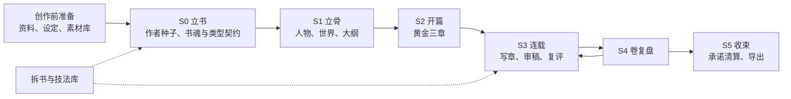

# ncc-workflow — Novel Create Center

ZCode 插件 · v3.2.0 · 五端项目级工作流

NCC 是面向长篇网文的本地创作工作流：从资料与设定准备、立书、写章和审稿，到拆书学习、复盘、收束与导出。你可以只给一句想法，由 `/ncc` 推荐下一步；也可以直接进入具体任务。经理窗口协调十二个角色，关键创作决定由作者确认。

创作前准备可独立使用，不要求书名、主角、大纲或 `book.json`。进入书项目后，`book.json` 与承诺、知情、世界三本账记录进度和连续性。写章先审场景卡，再写正文；写手、审稿和修订分开，正文变更后复评。关键章用多版比选和读者记忆测试，不给创意质量打绝对分。

## 接入与更新

共同源是 [cloudxy/ncc-plugin](https://github.com/cloudxy/ncc-plugin)。本仓库同时是创作工作区和插件开发现场。Claude、Codex、Kimi、Grok 通过仓库内项目级入口读取同一套技能、命令和角色；编辑源文件即更新这些入口。ZCode 在 `~/.zcode/cli/config.json` 的 `plugins.dirs` 中直接注册本仓库目录（本机已如此配置，改源文件后开新会话即加载）；其他机器也可以把仓库克隆到 `~/.zcode/local-plugins/ncc-workflow` 并注册该克隆，经 GitHub 同步，`git pull` 后再开新会话加载更新。

| 宿主 | 项目级接入 | 常用入口 |
|---|---|---|
| Claude | `.claude/skills`、`.claude/commands`、`.claude/agents` | `/ncc`、`/ncc-write` 等 |
| Codex | `.agents/skills` | 技能菜单或直接描述意图 |
| Kimi | `.agents/skills`、`.agents/agents` | `/skill:ncc`、`/skill:ncc-write` 等 |
| Grok | `.claude/skills`、`.claude/commands`、`.agents/skills`、`.grok/agents` | 命令或技能菜单 |
| ZCode | 本仓库目录直注册（其他机器可用独立克隆） | `/ncc`、`/ncc-new` 等 |

项目级入口随仓库存在；在相应 CLI 中打开本项目即可使用。各宿主的命令发现和参数语法以实际会话为准。完整命令对照和场景示例见[使用指南](docs/guides/usage.md)。

## 快速开始

以下是 ZCode 和 Claude 的斜杠命令示例；在 Codex 等宿主中，也可以直接说出相同意图。

```text
/ncc 我想写本书，但只有一个模糊的想法
/ncc-prepare 整理资料 ~/Documents/我的资料库
/ncc-prepare 创建一个由潮汐支配的城市设定
/ncc-prepare 治理素材库 ~/Documents/我的资料库
/ncc-new 都市+诡异，主角是守夜人学徒
/ncc-write 黄金三章
/ncc-write 接着写
/ncc status
/ncc-review 第12章
/ncc-deconstruct ~/Documents/对标书.txt
/ncc 这个单元写完了
/ncc 准备收尾
/ncc 导出成 epub
```

| 入口 | 用途 |
|---|---|
| `/ncc` | 一句话路由、状态、卡文、复盘、收束与导出 |
| `/ncc-prepare` | 整理、完善或创建资料和设定；治理现有素材库 |
| `/ncc-new` | 作者种子、书魂、人物与设定、大纲和开书闸门 |
| `/ncc-write` | 黄金三章、日更、攒稿与中断续写 |
| `/ncc-review` | 独立审章、修订复评与全书体检 |
| `/ncc-deconstruct` | 按章节索引拆对标书，沉淀设定和技法 |
| `/ncc-eval` | 锚定章回归与模型横评 |
| `/ncc-dev` | 维护本插件；`continue <任务号>` 恢复开发任务 |

## 流程总览



准备阶段用独立 `prepare.json` 管理来源、成果、关系、采用与待解问题。通用资料可留在准备工作区，进入具体作品时再选用。素材库治理会先诊断全部来源、制定适配规范，再分批整理内容与结构，最后检查全库和写作取用；方法见[创作前准备](skills/ncc-prepare/SKILL.md)。

立书和立骨从作者自己的想法开始，给候选与推荐，并在书魂、设定、大纲等闸门请作者决定。写章循环为“章节登记 → 场景卡 → 故事审 → 写作简报与读者此刻 → 草稿与台账回写 → 机械检查 → 硬伤审 → 修订复评 → 定稿”。单元、卷与全书复盘负责检查承诺、读者反馈和后续方向。阶段与状态由 [registry 分片](workflow/registry/) 维护，[registry.json](workflow/registry.json) 是兼容生成视图。

角色有按书和跨书的记忆，作者会话中的决定按角色切入派单；审稿和试读读者保持盲读。拆书产出的技法卡可供后续规划参考。审稿规则变更须经过锚定章回归和作者确认，不能由记忆自动改写。详细设计见[架构说明](workflow/architecture.md)与[信息架构七律](workflow/principles.md)。

## 项目结构与数据边界

| 路径 | 内容 |
|---|---|
| `workflow/` | registry/ 分片事实源、registry.json 兼容生成视图，以及原则与架构 |
| `skills/`、`commands/`、`agents/` | 八个入口及十二个创作角色的源文件 |
| `scripts/` | 运行入口与 ncclib/ 领域实现；dev/ 开发工具；tests/ 测试；旧开发入口保留转发 |
| `docs/` | [文档导航](docs/README.md)：使用指南、工程规范、模块设计、活动任务与验证证据 |
| `eval/anchors/` | 审稿回归所用的锚定章 |
| `novels/` | 私有书项目、准备工作区与拆书库，不进入 Git 仓库 |

书稿和素材只作为本地创作数据。`novels/`、`books/`、`_作者/`、`_拆书库/` 被忽略，提交钩子还会拦截书项目标记。拆书只处理作者合法持有的作品；使用原著时保留短定位引用及证据，不复制原文作为技法卡。

## 开发与验证

维护插件使用 `/ncc-dev <目标>`，任务恢复使用 `/ncc-dev continue <任务号>`。阶段、证据和交付要求见[开发工作流](docs/engineering/workflow.md)。测试按实际影响范围选择，局部改动只验证受影响部分，大范围改造才跑全量；创作规则实质变化须做相应行为验证并交作者确认，审稿判据变化再执行 `/ncc-eval 回归`。

在仓库根目录运行：

```bash
python3 -m unittest discover -s scripts/tests -t scripts -p 'test_*.py'
python3 scripts/dev/build_registry.py --check
python3 scripts/dev/check_plugin.py -v
python3 scripts/dev/build_docs.py --check
python3 scripts/ncc_eval.py mech
```

本机 ZCode 直接注册当前工作树，改完开新会话加载；其他机器的独立克隆经 GitHub 同步；提交前先 `git pull`，提交钩子会检查远端是否领先和是否误暂存私有内容。第三方项目只作设计参考，不属于插件的受管依赖或必需运行链。来源、转化与材料许可见[设计出处与致谢](ACKNOWLEDGMENTS.md)。
