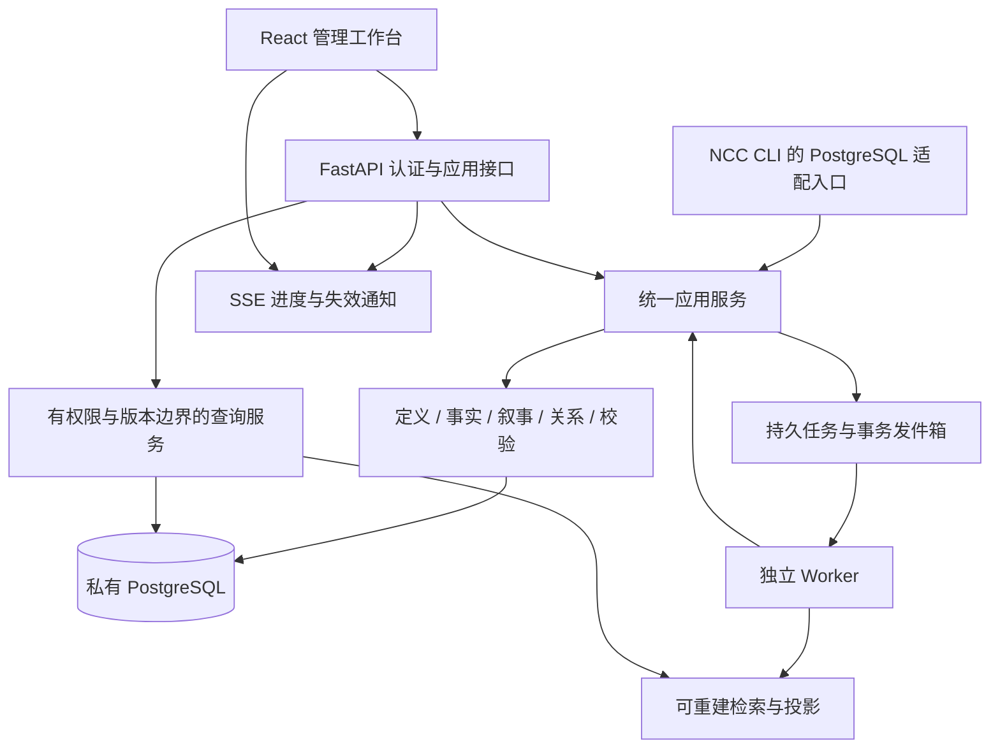

# 小说基础数据管理后台设计

> 2026-10-19已按作者授权进入实现。本文保留设计依据；其中“本轮仅设计/尚未实施”的叙述属于2026-10-18设计阶段，现行代码、能力与未验边界以[实施计划](implementation.md)、[使用指南](../../guides/data-console.md)和[实施证据](../../evidence/2026-10-18-postgresql-design/implementation.md)为准。


状态：设计候选，待作者审核，未实施。日期：2026-10-18。适用基线：ncc-workflow 3.2.0，`de8d1ab` 及[设计任务](../../tasks/2026-10-18-postgresql-design.md)登记的工作树。

本稿是[PostgreSQL 小说知识与叙事底座设计](postgresql-foundation.md)的管理应用方案。底座负责身份、定义、关系、时态、版本和事实语义；本稿负责作者如何在后台操作这些能力，以及接口、权限、任务、部署和验收。相关方案共同审核，本轮不编写表结构、DDL或应用代码，不安装依赖、不连接数据库、不迁移资料。

作者追加的[创作自动化与AI内容评分设计](creation-automation.md)统一规定日常入口、内部自动编排、人工介入、评分与返修策略。作者默认使用简洁创作台；本文的专业资料治理保留在高级管理中，详细内部步骤不要求作者逐项操作。三稿共同组成待审核方案。

## 1. 产品目标与交付边界

建设一个作者可以长期使用的专业数据工作台，管理共享资料、小说设定、叙事文本及其关系。作者不需要编写 SQL、编辑内部 JSON 或理解存储结构，就能完成以下工作：

1. 创建类型和属性，配置有约束的录入表单，发布一个可采用的定义版本。
2. 录入、搜索、批量整理人物、种族、功法、法宝、货币、地点、组织、典籍等资料，追溯每项信息的来源。
3. 维护世界事件和历史事实，查看任意叙述位置、世界时点、记录版本下的状态。
4. 编辑卷章、纲要和正文修订，关联人物、地点、剧情、伏笔及原文证据。
5. 操作关系图、组织架构、任职时间线与地图，而不丢失底层时间和版本含义。
6. 审查设定更改、处理冲突和 Retcon，导入导出数据，查看任务与审计，恢复误操作。

专业交付要求是“录入—校验—比较—采用—追溯—恢复”的操作闭环。页面美观、自动生成增删改查、OpenAPI 文档分别只解决部分问题，不能独立作为验收依据。

日常操作收敛为“表达目标—系统生成/评分/返修—查看结果—采用或修改”。准备上下文、故事审、事实检查、资料关联、台账和索引更新由系统编排；作者可随时直接编写、修改、暂停和接管。采用一次同时推进相关更新，质量达标且在明确托管授权内的任务可以自动采用。

作者已指定 Python、FastAPI；前端由开发方选型。本稿推荐 React 技术栈，作为完整方案的一部分供审核。当前仓库是文件型 CLI 工作流插件，尚无 FastAPI 服务、前端工程或数据库后台；本稿中的页面、接口和目录均为拟建目标。

## 2. 技术选型与职责

| 部位 | 选型 | 本项目中的职责与取舍 |
|---|---|---|
| 后端语言与 API | Python＋FastAPI＋Pydantic v2 | 分组 API、身份及范围依赖、静态请求契约和 OpenAPI；动态属性及跨对象规则仍由领域服务校验 |
| 数据访问 | SQLAlchemy 2 系列＋Psycopg 3＋Alembic | 事务、连接池、PostgreSQL 访问和物理迁移管理；本轮不确定物理结构，不运行迁移 |
| 前端 | React＋TypeScript＋Vite | 复杂数据页、动态表单、时态比较、图谱及正文编辑；采用浏览器 SPA，同源部署，后台不需要 SEO |
| 通用界面 | Ant Design | 表格、表单、树、抽屉、比较布局、步骤条、上传和反馈；围绕 NCC 语义封装，不整套复制第三方后台模板 |
| 路由与服务端数据 | React Router＋TanStack Query | 地址可恢复、范围切换、分页和请求缓存；不再同时引入另一套全局服务器数据仓库 |
| 文本编辑 | CodeMirror 6 | Markdown/纯文本、长文本编辑、修订比较入口和证据定位；不把富文本 HTML 当作唯一原件 |
| 关系视图 | Cytoscape.js | 关系展开、布局、筛选和路径查看；业务写入仍走变更命令 |
| 虚构地图 | OpenLayers | 本地底图、自定义坐标、地点标注和层级切换；不强迫虚构世界使用经纬度 |
| 持久任务 | 独立 Python Worker＋PostgreSQL 任务/事务发件箱机制 | 创作编排、评分/有限返修、导入导出、索引和投影等可恢复任务；先不强制增加消息中间件或微服务 |
| 进度更新 | SSE＋轮询补偿 | 任务进度、版本变更提示；断线后按游标补取，不用实时消息代替持久事实 |
| 自动化验证 | Python 测试＋真实 PostgreSQL 集成验证＋Playwright | 领域、权限、并发、任务恢复及浏览器操作链路；具体版本在实施开始时锁定 |

选择 React＋Ant Design，是为了同一套页面体系同时承接复杂表格、类型配置和领域交互；Vite 负责开发和构建。暂不增加 SSR 服务，也不把数据库后台套入一个只能按物理表生成页面的框架。Ant Design 提供表格和表单基础能力，业务的时态、正史与审查交互需要本项目实现。[Table](https://ant.design/components/table/)、[Form](https://ant.design/components/form/)

上述工具是未来拟用的运行依赖，遵循各自许可证并在实施时锁定兼容版本；不将参考项目源码放入 vendor，不新增第三方参考项目的自动更新链。Node.js 用于前端开发构建，部署成品可直接提供静态文件，作者日常使用浏览器即可。

## 3. 系统架构与工程边界



采用模块化单体，API 与 Worker 分进程运行。身份与范围、定义、实体、关系、事实历史、叙事、认知、治理、数据交换、任务和审计分别设模块；它们通过明确的应用命令与查询调用，不能跨模块随意覆盖数据。

创作编排调用生成、检查、评分、修订和采用服务；评分方案、报告和作者反馈独立版本化。模型适配器可替换，输出通过结构/证据/版本校验，总分由服务端计算，具体契约和预算见[自动化方案](creation-automation.md)。

API 路由只做请求解析、鉴权、调用和响应；业务服务负责整个操作的事务边界。前端、CLI 和后台任务使用相同规则，不能出现“网页检查很严格，CLI 直接写当前值”的第二条通道。查询服务可使用专用读模型，采用时必须返回实际数据版本与索引水位。

拟在现有仓库中隔离 Web API、Web 前端和共享数据服务。物理落点在实施设计时确定，可采用 `apps/management-api/`、`apps/management-web/` 与可独立导入的 Python 数据包。必须满足：

- 共享领域逻辑不依赖 React、FastAPI 请求对象或浏览器会话。
- 文件模式的原 CLI 不因安装后台而被迫启动 HTTP 服务；外部驱动和 Web 依赖只在对应后端被启用时加载。
- PostgreSQL 模式中的 CLI 可以直接调用受信的应用服务，或使用授权服务客户端；两者都携带操作者和范围上下文，禁止隐式超级用户。
- 工作流 registry、技能、角色及闸门仍以 Git 中的项目规则为准；后台可以显示版本、安装受管领域定义包，不能另设一个随意改写全局工作流的编辑器。
- 对外只开放应用接口，浏览器不取得数据库连接信息，也不直接连接数据库。

数据库访问统一采用异步链路。每个请求和每个并发任务有自己的 `AsyncSession`，不在并发协程中共享事务会话；事务由用例控制，失败完整回滚。同步文件解析和计算密集工作交给 Worker，避免在异步请求中阻塞。[SQLAlchemy 并发会话说明](https://docs.sqlalchemy.org/en/20/orm/extensions/asyncio.html#using-asyncsession-with-concurrent-tasks)

## 4. 信息架构、上下文与界面布局

### 4.1 全局上下文

后台打开后优先恢复最近有权限的作品和任务；首次或用户主动切换时选择作者资料库、共享世界或书项目，没有立书时也能整理资料。默认顶栏显示作品/资料范围、分支和保存状态；完整时间/版本口径按需展开，历史只读状态必须显著。

查看口径展开后，分别选择“世界有效时间”“系统记录截至版本”“叙述位置”“正文/发布版本”。默认显示“当前已采用版本”，不得只写含义不明的“当前时间”。第120章包含多段倒叙时，继续选场景或事件，不自动把整章映射为唯一世界时点。

URL 保存范围 ID、对象 ID、分支和视图选择，不保存令牌、正文或秘密内容。切换范围前处理未保存草稿；并行页签各保留自身上下文。作者资料库不强制带书 ID，所有书相关查询必须验证所属范围，不能只凭前端当前选择推断权限。

服务端缓存和 TanStack Query 缓存都必须区分身份/授权版本、内容范围、分支、时间与版本、筛选和分页。切书后即使实体同名，也不展示上一书缓存；权限变更或退出清理相应缓存。查询所依赖的变量须纳入缓存键。[TanStack Query 查询键](https://tanstack.com/query/latest/docs/framework/react/guides/query-keys)

### 4.2 默认创作台

默认只有“创作台、作品资料、我的待办”三个入口。主区域是当前正文/成果及目标输入，侧栏是评分、关键变化和少量待决定项；提供采用、告诉AI怎么改、直接编辑及暂停。当前作品、风格和进度自动继承，无歧义时不询问版本、时间或定义包。

流程按[创作自动化方案](creation-automation.md)执行，作者可以审核AI推荐，也可以主动介入编写和更新。任务进度合并显示，普通内部成功步骤不制造待办或审批弹窗。

### 4.3 高级管理布局

```text
┌ 内容范围 / 当前书 / 正史或分支 / 查看口径 ── 全局检索 ── 任务 ── 账号 ┐
│ 左侧导航 │ 面包屑、标题、版本和权限提示                              │
│ 资料管理 │ 搜索、组合筛选、保存视图、字段选择、导入与新建             │
│ 关系历史 │ 数据表格 / 图谱 / 时间线 / 地图                            │
│ 叙事管理 │ 详情抽屉：属性 / 关系 / 历史 / 出处 / 关联章节 / 变更        │
│ 数据治理 │ 选中范围与批量动作；编辑时显示草稿状态和差异预览入口         │
│ 系统管理 │ 校验结果、任务状态、可定位错误与操作回执                    │
└──────────┴──────────────────────────────────────────────────────────┘
```

桌面优先，主要编辑布局适配1280与1440宽度；小屏保留查看、任务和审批，复杂图形允许切成列表。列表位置、筛选与列宽可恢复。高级管理展示完整治理能力，创作台只突出推荐结果、评分、重要问题和作者动作，复杂度由系统承担。

## 5. 页面与功能清单

下表是目标功能清单，不表示现已可用。所有模块共用上下文、草稿/采用机制、审计、版本检查和授权。

本表是后台完整能力清单，不是作者默认导航。专业模块按上下文打开或进入高级管理。

| 模块 | 页面及主要操作 | 完成后可检查的结果 |
|---|---|---|
| 工作台 | 最近工作、待办、数据质量、任务失败、采用版本变化 | 每个数字可以下钻到受同一权限和统计口径约束的对象列表 |
| 创作编排与评分 | 自然语言任务、直接编辑/接管、生成检查返修、按类型评分、候选比较、作者反馈 | 一次任务完成内部链路；分数可解释、低分有限返修、晚到结果不覆盖人工修改 |
| 范围与书库 | 作者资料、宇宙、系列、书、分支、共享采用 | 能在未立书时管理资料；书明确采用哪个共享版本 |
| 定义中心 | 类型、组合能力、属性、单位、枚举、关系、约束、展示布局 | 新类型可预览、试填、检查兼容、发布和按范围采用 |
| 通用资料 | 多类型目录、实体列表、详情、新建、克隆、别名、合并/拆分 | 所列领域均有可用的通用录入入口，类型之间保留身份差异 |
| 关系与组织 | 关系表、局部图谱、组织结构、职位、任职、成员与驻地 | 时间、公开/隐藏、实际/名义关系有明确标识及来源 |
| 事实与时间 | 事件列表、状态时间线、历史查询、双版本比较、Retcon | 可回答“故事何时如此”和“作者何时记录/修正” |
| 叙事与文本 | 卷章树、正文修订、纲要/细纲、场景、节拍、剧情线、伏笔 | 原文锚点可定位，修改后能看到受影响的事实与审查 |
| 认知与揭示 | 命题、角色认知、信念来源、传播链、读者揭示矩阵 | 不把世界真相、角色误信、公开发言和读者已知合成一格 |
| 资源与生产 | 物品规格/实例/批次、归属/保管、配方、材料、库存、交易 | 可区分借用、持有、所有权；数量和货币计算精确 |
| 地理与世界 | 位面树、地点、地图、坐标系、路线、资源分布、层级 | 地图标注与地点实体双向定位，未知坐标仍可用拓扑表达 |
| 来源与典籍 | 原始资料、版本、语录、译文、注释、借鉴/改写、附件 | 出处可以回查；无法证实的归属保持待考状态 |
| 质量与审查 | 冲突、重复候选、断链、类型升级影响、正文证据失效 | 问题有规则版本、证据、影响、处理人和解决记录 |
| 变更中心 | 我的草稿、待审、差异、影响、采用、纠正、分支合并 | 多对象变化作为一个受控变更处理，失败不留下半项事实 |
| 导入导出与任务 | 上传、映射、预检、引用解析、试跑、正式采用、结果下载 | 可中断恢复、逐批追溯、下载失败明细和范围清单 |
| 权限与审计 | 成员、角色、范围授权、字段策略、操作和下载审计 | 前端无按钮也不能绕过 API；敏感下载有单独授权 |
| 运行管理 | 服务版本、健康、容量、索引水位、任务队列、备份/恢复报告 | 运维状态有实际探针；备份完成不自动等于恢复可用 |

能力范围包括底座方案中的16个领域。少数领域暂没有专用图形界面时，仍有通用列表、受约束表单、关系、历史和来源页；不能以“专用页以后再做”为由使这些内容无法管理。

## 6. 专业列表、详情与动态表单

### 6.1 列表能力

支持关键词、类型、标签、范围、状态、来源、关系对象和时间条件组合筛选；提供与/或分组、排序、多列排序、列显隐/固定/宽度、个人或授权共享的保存视图。筛选表达式使用允许的字段和运算符，后端限制层数、关系跳数和查询成本，不允许输入 SQL。

大列表服务端分页，稳定排序增加 ID 作为相同值时的次序依据；连续浏览默认游标分页。需要跳页的有界结果可采用快照页码，不能让“第3页”在无提示情况下漂移。总数昂贵时显示估算/待计算，不伪装成精确数量。虚拟滚动只处理渲染成本，不代替服务端分页。

“选中本页”“选中指定条目”“选中全部筛选结果”是三个动作。全部结果由后端冻结成员、版本和排除项，确认页给出数量、范围和影响。若规模超限，转任务执行；不能把只加载了100行的前端数组当作全量操作。

简单名称、标签等可行内编辑为草稿。归属流转、境界变化、任职、事实时间和共享采用必须进入对应业务表单；行内编辑也不绕过采用流程。支持重复候选提醒、批量填充、对比和授权导出，删除与合并必须先看引用影响。

### 6.2 统一详情页

详情页具有稳定链接，页首显示名称、身份类型、范围、当前采用版本和状态。标签页包括概览、动态属性、名称/别名、关系、历史、关联章节、来源/附件、变更与问题。每一条事实能查看来源、有效区间、记录版本、采用状态及相关变更。

克隆时明确选择“新实例”“复制设定为新对象”“引用共享对象”，不直接复制全部历史和身份。合并保留原 ID 的重定向及来源；拆分逐项分配名称、事实和引用，列出待人工判断项，不能按同名自动合并。

### 6.3 定义驱动的表单契约

后端向前端提供版本化的“可编辑描述”：定义 ID/版本、字段语义类型、约束、单位、是否多值、可空性、默认建议、引用目标范围、可用控件和布局。它是应用契约，不是物理表结构。前端通过受控控件注册表渲染：

| 语义 | 控件和限制 |
|---|---|
| 名称、短文本、长文本 | 字数及语言提示；长文本编辑器保留原件，预览与编辑分离 |
| 枚举、多选、标签 | 来源为版本化定义；停用项可显示历史，不静默改成空值 |
| 整数、精确数、数量/单位 | 精确十进制按字符串传输；精确比率保留分子/分母；单位维度校验，不靠 JS 浮点换算货币 |
| 世界时间、区间、模糊时间 | 选择虚构历法、相对事件或未知；不得强制填公历日期 |
| 实体和跨书引用 | 有权限的远程搜索，显示类型、范围、版本；待解析引用单独标识 |
| 地点、坐标、层级 | 选择坐标系与精度，允许仅拓扑关系和未知坐标 |
| 证据和原文定位 | 选择受管源版本、章节修订和锚点，展示定位失效状态 |
| 规则/条件 | 有限运算符和条件构造器；不运行作者输入的 Python、JS 或 SQL |

前端校验负责即时提示；API 必须重新执行结构、动态定义、权限、引用、时态和业务校验。新增已有语义下的“异火”应自动获得列表、表单、关系和历史页；新增一种全新值类型或算法需要开发对应受版本约束的后端和控件，不能伪称全部配置化。

打开旧草稿后发现定义升级，先展示旧版与新版差异、废弃字段和转换预检。未知控件或不兼容定义进入可读/受控导出状态，保留原值，不能通过忽略未知字段让保存“成功”。默认值是录入建议，只有作者采用后才成为事实。

## 7. 草稿、变更、采用与恢复

### 7.1 变更状态与权限

所有正式数据修改通过变更集，至少区分：草稿、已提交待审、退回、已批准、已采用、已撤销。冲突和校验失败是可解释的处理状态；已采用历史不可原地改写。

草稿可自动保存到服务端草稿区，显示最后保存时间、基线与失败重试。自动保存不进入正史、不推进读者揭示、不触发正式文本审稿通过。跨书、跨分支、跨对象的变更明确列出边界；跨多个权威库无法保证原子性时必须拆分并显示依赖，不能声称一个事务。

个人作者默认可兼任编辑和批准者，一次采用完成相关更新；可按明确任务范围授予托管策略，在达标和授权有效时自动采用，不逐项确认。底层保留草稿、校验、授权依据、事务回执和审计。团队可要求编辑/批准分离；质量评估不自行授予写权限，AI产出者不能凭自评批准自己。

### 7.2 一次操作的完成步骤

下列步骤由服务端编排。作者默认只表达目标、查看最终结果/评分并采用或修改；仅对未授权的重大变化和无法自动处理的冲突集中介入，不逐步骤点击。

1. 读取对象和相关定义版本，建立基线；编辑产生操作意图，不直接覆盖当前投影。
2. 保存草稿并校验；预览逐字段、关系、世界时间、来源、章节和共享采用的差异。
3. 计算影响：受影响事实、引用、伏笔、文本锚点、审稿、导出与索引，区分阻断、警告和提示。
4. 按本次作者采用或有效托管策略取得批准依据，绑定草稿、依赖、校验/评分方案及有效期；输入或依赖变化后复核，不复用过期批准。
5. 正式采用时服务端再次鉴权、核对依赖和并发条件，在事务内写入事实/修订、审计、幂等回执和发件箱；必要的结构不变量由数据库约束兜底。
6. 成功后返回采用回执与实际版本。异步索引失败单独提示和重试，不能将已经提交的数据假报为“保存失败”而诱发重复创建。

预览令牌只绑定输入及检查结果，不授予未来写权限。关系排他、任职重叠等规则在并发事务内再验证；仅比较主实体的版本不足以保护跨对象不变量。

### 7.3 冲突、撤销与删除

两个窗口或 CLI 同时修改时，按基线版本拒绝陈旧覆盖，显示“我的草稿/原基线/当前采用版”三方差异。无交叉变更可生成合并建议；有交叉变更由作者逐项决定，重新校验，不能靠最后保存者覆盖。

未采用草稿可撤销；已经采用的变更通过新的纠正/补偿变更恢复，保留原回执。对象停用/墓碑、作者撤回事实、故事内死亡/毁灭、隐私彻底清除分别操作。停用不切断既有历史引用；彻底清除遵循底座中的备份生命周期和审计最小化规则。

历史只读视图中的“更正”创建以该版本为依据的新变更，明确纠正范围和影响当前正史的方式；不能把历史页当普通表单直接保存。

## 8. 关系、时间、组织、地图与叙事的专用操作

### 8.1 关系图谱和组织结构

以一个对象或有界集合为中心按需展开，筛选关系类型、方向、有效时间、公开/隐藏及采用状态。节点点开统一详情；边点开关系的来源、时间和修订。图谱和表格使用相同查询范围，图上未加载的节点不代表不存在。[Cytoscape.js 官方文档](https://js.cytoscape.org/)

拖动节点只保存布局偏好，不改变从属和城池位置；画连线会打开带关系类型、方向、时间、来源和权限的变更表单。对多方交易、契约和战役，显示事件节点及参与者角色，不能压缩成一个含义不清的两点连线。

组织页按行政隶属、作战指挥、秘密控制等关系分别投影。树状视图之外保留多重隶属、兼职、实际控制与名义任职。设任长老的流程包括：选择组织和职位、任职人、世界时间、起止叙述锚点、是否独占、名义/实际、来源；后台检查同期冲突及循环指挥关系，显示适用规则。

### 8.2 历史查询与 Retcon

事实时间线用世界有效区间排布；记录历史用系统修订顺序排布，两条轴明确命名。可并排查看“第120章场景中的世界状态”“以当时记录为准”和“以现有修正为准”的差别。未知、约在某段时间及未确定先后关系保留不确定性，不伪造精确日期。

Retcon内部流程：定位事实/版本 → 解析修正范围/理由 → 分析章节、认知、伏笔、审稿影响 → 明确分支或正史 → 预检/评分 → 采用和复核。作者可以自然语言发起，系统汇总一个影响方案；修正范围经本次指令或有效授权明确后自动执行，未授权的实质变化集中询问，不逐字段确认。

分支基于固定基线创建，分支页显示继承范围、本地变化与共享版本。合并时对定义、实体、事实、关系和文本分别作三方比较；无法自动合并的逐项解决。合并后的批准必须绑定最终差异，不能沿用解决冲突前的批准。

### 8.3 叙事编辑与证据定位

左侧卷章树，中间正文/细纲编辑，右侧人物、地点、伏笔和待处理影响。卷章重排操作使用稳定节点 ID，预览编号和相邻引用变化；正文修订独立于章序，不能因为重排把原文证据重新绑定到另一章。

正文保存产生新修订；正式采用后，依赖旧正文摘要的审稿与锚点标为待复核。证据定位结合源修订、段落身份和内容摘要；文字移动可建议重新定位，原文删除或歧义必须人工确认，不能只保存字符偏移。

纲要计划、已发生剧情、正文提到的传闻分别显示。伏笔页同时显示计划埋设/回收、实际埋设/强化/兑现、证据、承诺范围、章节覆盖和连续未提及数量；存在未处理章时显示“覆盖不足，暂不能判断”，不能直接报断线。

节拍标注按卷/剧情线聚合；标签数量不直接换成质量分。AI成果通过[按类型评分](creation-automation.md)，将任务完成、质量分项与证据共同呈现；保留故事审、硬伤检查、关键候选比较和正文新鲜度，评分及自动化接入旧CLI前需相应行为验证。

### 8.4 认知与信息差

以命题为行、人物或读者视图为列，查看知道、怀疑、误信及其依据。态度、置信、来源和世界真假分别展开；公开否认单列为发言/表达，不能覆盖真实信念。筛选“此章角色不应知道的内容”，跳回取得信息的事件和原文。

预览“某角色截至某章”或“读者截至某章”时，必须由后端重新生成受限响应，不能先发送全部真相，再由浏览器隐藏。作者可以有全知管理权限，调用 NCC 角色上下文仍按其工作职责裁剪。

### 8.5 地图、数量、配方与典籍

地图支持底图版本、坐标系、层级、地点标注、路径和有权限的图层；支持城池迁移、改名、毁灭的历史视图。拖动地标是一个“变更坐标”草稿；地点与组织驻地不是同一对象。虚构空间可采用图片坐标系，不必伪装地球地图。[OpenLayers 静态底图及自定义投影示例](https://openlayers.org/en/latest/examples/static-image.html)

物品页分别操作规格、实例、批次和数量；流转向导区分所有权、保管、借用、认主，给出区间与来源。库存调整和货币换算有单位/币种及条件，不直接改一个余额字段。丹方/锻造配方页把材料、比例、条件、产物、副作用与实际生产批次分开；本期提供维护能力，推演算法在独立能力验收后接入。

语录页并排保留原文、出处版本、译文、注释、转引和本书改写；有“已核实/转引待核/归属存疑”等来源状态。“佛家/道家/法家/墨家”可作为分类，不能据此自动判定作者和原书。附件从详情可追溯、按权限下载，不能暴露服务器路径。

## 9. 五条代表性业务流程

| 场景 | 作者操作步骤 | 失败处理与完成依据 |
|---|---|---|
| 新增“异火”领域 | 在定义中心组合可命名/有品阶/可认主能力；定义属性和关系；预览试填；检查样例与兼容性；发布定义包；在目标书采用；新增异火实例并关联章节 | 错误指向字段或约束；发布不自动升级其他书；通用页面能维护并查历史才完成 |
| 法宝由甲转交乙 | 从法宝详情选“流转”；选转移所有权或仅保管；填写事件、时间、来源、分支；预览甲区间关闭和乙区间打开；采用 | 同期冲突阻断，两个并发转交只能按规则完成；甲乙和物品历史的回执一致 |
| 追溯修正境界 | 选历史事实；将修正有效起点设为某事件；查看后续战斗、人物认知、纲要和审稿影响；采用修正；逐条处理待复核 | 保留原记录视角，不能覆盖证据；当前和历史查询各符合选择的记录版本 |
| 批量导入角色与语录 | 上传；选择范围/定义版本；字段映射；姓名去重候选与出处解析；预检；修复阻断；确认冻结清单；分批采用 | 原件和未识别字段保留；重复重试不多建；失败批与成功批均有明确回执 |
| 调整章节并补伏笔回收 | 预览章序变动；采用重排；编辑目标章生成正文修订；重绑原文证据；登记实际回收；运行受影响检查 | 章 ID 不变；旧审查失效可见；无实际证据的计划不计已回收 |

这些操作链路在实现时须可通过界面独立完成。若必须手工改库才能结束，说明后台能力尚未交付。

## 10. API 契约与前后端协作

### 10.1 接口分组

以下路径是设计示例，正式命名在契约阶段冻结；不是已存在的端点，也不是表结构。

| 分组 | 示例接口 | 关键语义 |
|---|---|---|
| 身份与范围 | `GET /api/v1/me`、`GET /api/v1/scopes` | 返回有权限的范围与可执行动作，不能返回无权对象作前端过滤 |
| 定义 | `GET /api/v1/scopes/{scope_id}/definitions`、`POST …/definition-releases` | 查询采用版本、保存定义草稿、预检和发布；区分全局发布与书内采用 |
| 实体与检索 | `POST …/entities/search`、`GET …/entities/{id}` | 有界筛选树、分页、独立类型和属性版本、来源及可用动作 |
| 图谱与历史 | `POST …/relations/query`、`POST …/state/query` | 带范围、分支及四种查看坐标，返回解释和实际解析版本 |
| 叙事与认知 | `GET …/narrative`、`POST …/knowledge/query` | 稳定节点及修订、证据锚点、命题/角色/揭示范围 |
| 草稿和变更 | `POST …/change-sets`、`PATCH …/change-sets/{id}` | 保存命令意图与基线，不能 PATCH 正史投影绕过历史 |
| 校验与采用 | `POST …/change-sets/{id}/validate`、`…/submit`、`…/approve`、`…/apply` | 绑定草稿、定义、规则和依赖版本，采用事务重检；允许个人策略合并交互 |
| 导入导出 | `POST …/imports`、`POST …/exports`、`POST …/imports/{id}/preflight` | 有原件、范围、映射、预检及清单；大任务返回202和任务位置 |
| 任务与通知 | `GET /api/v1/jobs/{id}`、`POST …/cancel`、`GET /api/v1/events` | 权限检查、进度水位、恢复游标、取消边界，不以 SSE 消息作为完成凭据 |
| 审计与运行 | `GET …/audit`、`GET /api/v1/operations/status` | 只读和敏感操作分别授权，面向运营的探针与受限任务 |

`…` 表示对应范围前缀。对象 ID 即使全局唯一，也必须验证它与路径范围、操作者、分支的关系。全局管理端点独立授权。接口返回业务 DTO，不能直接序列化 ORM 对象或内部审计/隐藏属性。

### 10.2 通用读写规则

- 静态 API 契约从 OpenAPI 生成 TypeScript 类型；动态表单另有版本化定义描述，两者不能相互替代。保留兼容窗口和明确的不兼容错误。
- 列表返回条目、分页游标、数据版本和查询口径；图谱/全文返回截断标记、可继续加载位置和索引水位。不能悄悄截断后声称完整。
- 数量和价格等精确数以十进制字符串和单位传输；不能有限小数表达的比率使用精确分子/分母，分母不得为零；换算目标精度、舍入规则和余量处理显式指定，保留原比率。世界时间使用底座的结构化语义，UTC时间只用于系统记录与显示时区。
- 对已有草稿更新要求 `If-Match`/强版本条件；前置条件不满足返回412，业务依赖冲突返回409；缺必需版本条件返回428。正式采用还需完整依赖验证，不能只靠一个对象的 ETag。[HTTP 条件请求语义](https://www.rfc-editor.org/rfc/rfc9110.html#name-if-match)、[428 状态](https://www.rfc-editor.org/rfc/rfc6585.html#section-3)
- 创建和采用等可重试命令携带幂等键，按操作者、范围、操作及请求摘要绑定。相同键与相同请求返回原结果；换参数不得复用旧键；历史回执可查询，过期/清理策略不得造成已采用操作被当作全新命令。
- 禁止服务端盲信客户端提供的操作者、已批准状态、来源权威等级或可见字段。批量操作逐对象检查，跨对象规则按事务或明确的批次边界执行。
- 普通写入接口只接受明确可写的字段，未知字段、只读字段和未支持的定义版本报可定位错误，不通过默认忽略让请求假成功。批量导入的未知原始载荷保存在暂存报告，经映射后才能采用。

### 10.3 错误与观测

采用 `application/problem+json`，提供稳定业务错误码、用户可读说明、字段路径、可授权展示的冲突对象、重试方式和 trace ID。401用于未认证，403用于已认证但无权，必要时对对象存在性统一返回404；422用于可定位的输入/语义校验问题；429含重试提示。页面保留草稿并定位问题，不只弹出“系统错误”。[RFC 9457](https://datatracker.ietf.org/doc/html/rfc9457)

错误响应和日志不得回显整段请求正文、令牌、连接串或无权事实。域内变化、API 请求、任务、索引和下载使用关联 ID，支持从采用回执追到任务和失败原因。

## 11. 长任务、批量导入导出与附件

### 11.1 可恢复任务模型

长任务至少有排队、执行、等待用户处理、请求取消、成功、部分成功、失败、已取消状态，并记录阶段、已处理/总量、心跳、尝试次数、检查点、输入版本、结果和错误清单。未知总量显示未知，不伪造进度百分比。

业务采用与待执行任务通过事务发件箱一起持久化；Worker 领取有租约的任务，定期心跳，租约到期可重新领取。租约/栅栏令牌阻止失去租约的旧 Worker 继续提交；每个阶段使用业务幂等和唯一回执。处理语义按“至少一次投递＋可重复执行”设计，不承诺消息系统天然恰好一次。

可用 PostgreSQL 的跳过已锁定任务机制实现多 Worker 领取，但它只用于队列调度，不能用于普通事实查询来回避业务冲突。[PostgreSQL 锁定子句](https://www.postgresql.org/docs/current/sql-select.html#SQL-FOR-UPDATE-SHARE)

任务中心支持重试失败阶段、查看错误、取消未提交批次和下载明细。取消不能撤回已经提交的数据，已完成部分需生成补偿变更。毒任务达到重试上限进入人工处理；设置单书/用户配额及优先级，避免全库重建挤占写作查询。权限被撤销后，未提交阶段停止，结果下载重新鉴权。

FastAPI `BackgroundTasks`用于响应后短任务，不能独自承载本方案要求的持久恢复和任务治理。导入、导出、检查和索引进入上述独立 Worker；未来迁入成熟队列时保留任务 ID、幂等及回执契约。[FastAPI 官方说明](https://fastapi.tiangolo.com/tutorial/background-tasks/#caveat)

### 11.2 导入的操作步骤

1. 上传到私有暂存区，检查大小、文件类型、编码、内容摘要和来源，原件登记；大文件分块上传并校验完整性。
2. 选择目标范围、分支和定义版本；支持 JSON/JSONL、CSV、Markdown 及受管目录清单的明确格式，格式版本与内部实现解耦。
3. 映射字段、单位、名称和时间表达；未识别字段保留在导入报告，不能静默丢弃。正文、设定和引用的映射分别统计。
4. 生成同名候选、待解析引用、无权/跨范围引用、重复记录和规则冲突清单；作者逐项或按可说明的策略处理，不按名字自动合并。
5. 运行预检与试导入，展示预计新增/关联/纠正/停用数量、失败项、依赖版本和影响；试跑不修改正史。
6. 作者确认冻结清单，按可承受的事务批次采用。每批保留输入范围、前置版本和回执；跨批依赖明确，待解析引用未解决的项保持候选，不能冒充已确认关系。
7. 对账原件、语义映射、条目及引用数，提供失败重试和完成报告。整个作业部分完成时如实标识，不能称为全量原子导入。

导入解析限制递归深度、条数、解压比和资源用量；不能按上传内容读取任意服务器路径、执行宏或抓取任意远端地址。需要远程资料连接器时另有授权、网络访问与来源契约。

### 11.3 导出和附件

导出先选择内容范围、版本、视图及格式，冻结读取水位和可见对象清单；产物包含格式/定义版本、稳定 ID、原件校验及完整性清单。作者完整备份、业务交换和读者百科是不同导出模板，读者模板必须按发布快照裁剪，不包含隐藏名称和附件。

创建任务、执行阶段和下载时均鉴权；下载令牌短期有效、绑定授权，产物有有效期和清理策略。CSV 面向电子表格的安全输出与无损原始交换分开标识，处理公式注入并保留原值的可恢复表示，按目标软件验证，不能承诺所有消费者通用安全。导出任务是读取，不自动授权上传到远端。[OWASP CSV注入说明](https://owasp.org/www-community/attacks/CSV_Injection)

附件管理包括原件、修订、类型、大小、摘要、出处、引用、缩略图和范围授权；预览失败可下载有权原件，危险类型不在主站同源执行。采用外部附件存储时同样检查版本、授权、备份与缺件，不因数据库有记录就宣称附件已恢复。

## 12. 身份、权限、私有性与协作

### 12.1 角色与范围

后台权限按“主体＋范围＋动作＋对象/字段策略”判断。角色只是权限集合，可以组合；用户在不同书中可有不同权限。

| 角色模板 | 默认能力 | 需要单独授予的能力 |
|---|---|---|
| 所有者 | 管理本范围内容、成员和采用策略 | 其他作者资料、系统运维、外部发布 |
| 资料编辑 | 创建草稿、整理来源、提出关系和事实变化 | 正史采用、跨书共享、整库导出 |
| 审查/批准者 | 查看指定差异、证据和影响，批准或退回 | 编辑原稿、扩大自己的范围或字段权限 |
| 只读研究者 | 检索授权资料和历史，查看受限图谱 | 写入、下载原件、隐藏设定与批量导出 |
| 运行维护者 | 服务状态、任务调度、受控备份操作 | 默认不能浏览所有书稿；恢复私有库需额外维护授权 |

作者一人使用时由单一账号拥有所需组合，操作无需虚构多个工作人员。生产维护凭据和内容权限分离；备份操作者可能接触完整私有数据，必须显式授权并记录，不以“运维只看状态”掩盖该能力。

这套角色独立于 ncc-workflow 的创作角色。作者全知后台、写手上下文、连续性审稿和盲读试读使用不同查询策略；不能因后台账号能读全部数据，模型上下文便自动取得全部秘密和审稿答案。

### 12.2 登录、会话及浏览器数据

默认本机回环地址部署也有登录和明确的管理员初始化流程，初始口令不硬编码、不写仓库。浏览器同源使用服务端可撤销会话，Cookie 设 `HttpOnly`、适当的 `SameSite`，HTTPS 下设 `Secure`；局域网/远端部署启用 HTTPS。写请求校验 CSRF 令牌及 Origin，SameSite不作为唯一防线。会话有空闲/绝对期限、登录限速和注销撤销。以后接入 OIDC 时，通过身份适配替换登录来源，领域授权仍由本系统执行。[OWASP 会话管理](https://cheatsheetseries.owasp.org/cheatsheets/Session_Management_Cheat_Sheet.html)、[CSRF 防护](https://cheatsheetseries.owasp.org/cheatsheets/Cross-Site_Request_Forgery_Prevention_Cheat_Sheet.html)

CLI/自动化使用独立可撤销凭据，绑定范围、动作、期限及审计主体；不复用浏览器 Cookie 或让所有任务共用管理员身份。高敏感导出、权限扩大和清除操作可要求重新认证，触发规则写在策略中，避免普通录入不断打断。

服务端强制读写授权，覆盖列表、搜索提示、统计、关系边、历史、导出、附件、任务、SSE 和缓存。前端菜单和按钮仅体现能力；数据库 RLS 可作为附加隔离，仍须覆盖绕过 RLS 的角色、连接池上下文清理与应用业务规则。

历史查询使用当前仍有效的权限，不能通过选回旧记录时间恢复已撤销访问权。书的数据历史、读者揭示历史和真实用户权限历史分别记录；授权快照用于审计，不自动成为当前访问凭证。

浏览器默认不将书稿和令牌持久化到 localStorage，不启用缓存私有正文的 Service Worker；服务端草稿用于断线恢复。将来提供本机离线工作区时，单独设计加密、设备授权、冲突合并和撤销能力。退出、切换账号和授权失效清理内存缓存及预览产物；响应缓存策略、错误跟踪与前端遥测不采集正文。Markdown/附件预览清理危险内容，正文不作为可信 HTML 注入。

### 12.3 协作边界

首个专业版本提供多账号、细范围权限、评论、待办、批准和乐观并发；可展示其他人正在编辑的提示，但不宣称已具备多人逐字实时合写。实时合写保留正文修订、作者归属和冲突适配契约，后续选用协同算法时单独验收，不能把在线状态提示当作协同编辑。

审计记录操作者、来源通道、时间、范围、对象、变更集、前后版本摘要、理由和结果；应用账号不可普通编辑删除审计。数据库管理员仍可能改变底层数据，若需抗管理员篡改，另采用外部不可变审计介质及校验，不把普通审计表宣传成绝对防篡改。

## 13. 部署、升级、监控与恢复

### 13.1 两种部署形态

本机模式：一个受管 PostgreSQL、API、Worker 和静态前端，默认监听回环地址。提供启动、停止、状态、日志位置、备份和恢复说明，不要求作者手动操作多个开发终端。当前已有 PostgreSQL 的环境先盘点，不能为了后台另起一个同端口实例或覆盖原库。

局域网/服务器模式：同源反向代理提供 HTTPS、静态前端和 API；API 与 Worker 独立进程，数据库仅受信网络可达。初期可用进程管理或容器组合部署，二者择一形成可重复手册，不同时维护多套必需平台。远端使用不自动授予公网开放权限。

前端构建产物、API、领域定义包、数据契约和投影版本进入发布清单；API 启动检查兼容范围。物理迁移由受控升级步骤执行，不能每个 API Worker 启动时竞相修改结构。先兼容扩展、迁移和对账，再停用旧字段/接口；应用回退是否可行由数据兼容性决定，不能仅替换旧镜像宣称回滚。

### 13.2 运行管理页

显示活性/就绪状态、数据库连接及等待、API延迟/错误、慢查询摘要、容量、Worker心跳、排队年龄、失败/重试任务、索引水位、未处理发件箱、备份与恢复演练日期。敏感配置仅显示脱敏状态，不提供任意 SQL、Shell 或服务器文件编辑入口。

有权限的运维命令包括暂停新写入、排空队列、重建指定范围投影/索引、运行对账、发起受控备份和创建隔离恢复演练。任务参数受约束，调用专用运维适配，不借用正常应用数据库账号的超级权限。

### 13.3 备份与恢复操作链

备份策略沿用底座的 RPO/RTO 候选目标，实施时按容量冻结，不把15分钟/1小时当成已验证事实。完整范围包含数据、文本和附件、定义与采用版本、身份授权、任务回执、配置/密钥恢复办法及软件版本清单；密钥与密文分开受控保存。

恢复演练先选备份/恢复点 → 建隔离目标 → 校验清单和附件 → 对账代表性历史查询、权限及回执 → 检查任务租约与未完成作业 → 重建可丢弃索引 → 出具耗时/缺件报告。演练环境默认停用外部发布和通知，未完成写入任务不得直接对生产重复执行。

覆盖生产库是单独的维护流程：进入维护状态、冻结写入并排空/冻结任务、保留恢复前快照、明确恢复水位与影响，再受控切换，完成后验证凭据撤销和新写入；不能是普通管理员页面里的一个无边界“恢复”按钮。对底座/CLI 的切换与回退继续执行总方案“与 ncc-workflow 的接入及迁移”，网页后台没有第二套迁移捷径。

## 14. 界面质量与候选运行指标

### 14.1 交互质量

- 页面明确区分加载、无数据、无匹配结果、无权限、失效、错误与部分结果；错误可重试且不丢草稿。
- 关键动作支持键盘、可见焦点、明确字段标签和错误定位；颜色之外提供文字/图标状态。图谱和地图提供列表替代，实施时检查中文输入法、粘贴、撤销和长文本定位。
- 支持列布局和视图偏好、复制稳定链接、返回原列表位置、操作回执和任务跳转。大批量/破坏性操作显示明确范围、数量及影响，普通低风险编辑减少重复确认。
- 所有日期显示注明系统时区；故事时间、叙述章序和修订号分别命名。未知值、空值、继承值与计算值有区别。
- SSE 或轮询发现他人更改时，通知当前页并使读缓存失效，不覆盖未保存草稿。断网后显示保存状态，恢复连接按基线重试或合并，不静默宣称已保存。
- 浏览器支持范围先冻结当前主流 Chrome/Edge、Safari、Firefox 的受测版本；不把响应式等同于完整移动端编辑应用。

### 14.2 可测量的候选指标

沿用总方案的单书3000章、1000万汉字、5万实体、50万事实及多书10倍、4并发操作员的合成负载。实施时固定 CPU/内存/磁盘、数据库与浏览器版本、网络和冷/热缓存条件，以下均为待测目标：

| 场景 | 候选目标与限制 |
|---|---|
| 单对象/指定时点状态 | 后端P95≤300毫秒；常用限定查询与中文检索P95≤1秒，沿用底座口径 |
| 首屏与常见列表 | 本机同源、产物已构建条件下，主工作台可操作≤2秒；翻页从操作到内容稳定P95≤1秒，不含明确的后台作业 |
| 图谱 | 默认最多展开2跳、500节点/1000边，超限要求缩小范围或分段；固定样例首次布局≤2秒，阈值可配置并显示截断 |
| 正文编辑 | 按章加载，先验证单章5万汉字样例的中文输入和定位，无整本加载；超长章节给出分段策略与原件一致性验证 |
| 长任务 | 可查询持久状态；在线进度更新目标≤2秒，异常断线按查询恢复；总量和吞吐单独统计 |
| 并发正确性 | 两个浏览器/CLI 的冲突不得丢写；重试不得重复采用；服务/Worker重启后回执及已提交批次不丢失 |
| 权限 | 受限对象在正文、图谱、自动补全、统计、历史、任务、附件、缓存和导出中均不泄露；测试所有入口 |

数量阈值是资源边界，不意味着业务只允许500个实体。正式指标通过代表性测量冻结，达不到时调整查询/索引/布局或分批方案，不偷偷缩小测试集。不能通过把常规列表改成“正在后台处理”来规避交互指标。

## 15. 实施阶段、依赖与交付办法

本节是设计通过后的执行方案。每个阶段在确定候选上验证，失败退回本阶段或被影响的契约阶段，不以已建页面数量衡量完成度。

| 阶段 | 具体工作和产物 | 前置、验证与回退 |
|---|---|---|
| M0 契约与操作原型 | 冻结三入口创作台与高级管理、上下文、定义/变更/权限/任务契约，P1–P5量表与锚点；走查自动创作及原五条资料流程 | 依赖底座A；合成样例，无需作者逐项操作内部步骤，不接真实书库 |
| M1 第一条贯通链路 | 登录/范围、定义实体、创作编排、评分与有限返修、一键采用、资料同步、审计及版本冲突 | 依赖底座B/C；新增异火及一份创作成果端到端贯通；文件模式可用；失败停候选库 |
| M2 领域与叙事工具 | 关系/组织/任职、双时间线、分支、地图、物品流转、正文/纲要/伏笔、认知/揭示、出处附件；16领域通用入口全部可操作 | 依赖底座C/D/E；用“后台验收场景”中的相关场景验证；单模块失败可停用专用视图，保留通用操作与原件 |
| M3 专业治理闭环 | 多账号权限、托管授权、评分校准/争议/反馈、影响/Retcon、定义升级、持久任务、批量导入导出、恢复与运维 | 依赖底座B–E；故障、越权、评分误放、任务恢复均验证；不达标不启用自动定稿/真实试点 |
| M4 接入与试点 | 全入口共用业务服务；私有受控影子导入、差异对账、性能和浏览器验证、部署升级/回退手册；经作者决定试点 | 对应底座F；M1–M3及最低专业验收通过后才允许切换；回退按切换前/后两种数据状态执行 |
| M5 发布与观察 | 冻结候选、记录构建及契约版本、独立评审、正式发布回执、真实宿主/浏览器验证和观察 | 对应底座G；必要检查缺失保持待验，不以本设计检查替代；按明确故障条件暂停扩大范围 |
| M6 后续增强 | 语义检索供应商、实时合写、复杂世界模拟、多书公开百科、高级图谱/地图分析等 | 对应底座H；沿现有契约新增能力，每项独立定义样例、权限与成本，不推翻身份和历史 |

**首个可供长期使用的专业版本必须完成 M1–M4 中对应的功能和验收。** M1只是贯通原型；专业版包含简洁创作台、AI成果评分/有限返修/人工介入，以及动态资料、关系历史、叙事关联、治理、权限、导入导出、任务/备份恢复和CLI一致性。未校准时评分作为参考、成果集中审核，不冒称支持自动定稿；高级模拟与实时合写后续交付。

各阶段提交：范围与契约版本、页面清单、合成输入和预期/实际结果、浏览器/数据库环境、异常恢复证据、性能报告、已知限制、部署及回退操作。只有范围明确且可验证的小批次才进入实现，具体工期在环境和首条链路探针后估算。

## 16. 后台验收场景

下列场景追加于总方案的24个数据语义场景。实施时以合成小说/资料包验证；表中预期是未来验收要求，本轮未执行功能测试。

| 编号 | 操作/故障场景 | 必须观察到的结果 |
|---|---|---|
| A01 | 没有书项目先整理墨家语录和灵石定义 | 作者资料库可用，来源和采用状态明确，不强制创建主角/大纲 |
| A02 | 后台注册异火并增加品阶/认主关系 | 不新写专属页面即可录入、检索、查关系与历史；约束前后端一致 |
| A03 | 旧草稿遇到字段停用、枚举和控件升级 | 展示差异及转换预检，不静默丢值；不兼容时可读/导出并阻止危险保存 |
| A04 | 连续切换两书、分支和历史版本 | 表格、详情、搜索提示、图谱与缓存均在所选范围，未保存草稿得到处理 |
| A05 | 两窗口及CLI同时改同一事实 | 陈旧保存被拒，草稿保留，可三方比较；无最后写入覆盖 |
| A06 | 两人同时将独占法宝转交不同人物 | 事务约束阻断矛盾；回执可追溯，所有权和保管不会被混写 |
| A07 | 批准后他人修改依赖/权限，再点击采用 | 采用重新验证并拒绝陈旧批准，不以预览令牌绕过检查 |
| A08 | 保存成功后断网，再次点击；同时索引任务失败 | 幂等返回原回执，事实不重复；页面分别显示采用成功与检索待更新 |
| A09 | 查询第120章倒叙状态，并追溯修改境界 | 提示选择场景/事件；世界状态、记录历史及修正影响可解释 |
| A10 | 多重指挥、兼任、卧底关系和同一职位任职重叠 | 视图保留不同关系；按所选规则报冲突，不强压成单一树 |
| A11 | 角色误信、公开否认，读者已知真相 | 三种视角分别正确；受限响应及网络载荷不包含未授权真相 |
| A12 | 重排章节、改正文、移动/删除证据段落 | 稳定ID与旧修订保留；锚点待重绑，旧审稿失效可定位 |
| A13 | 伏笔规划有回收，但未写入正文且部分章未处理 | 不算已兑现；告警标明覆盖不足，统计可回查证据 |
| A14 | 图谱超限、地图无坐标、位面有不同坐标系 | 有截断与继续操作，图表语义一致；未知坐标不被伪造 |
| A15 | 输入超大灵石数、分数汇率和不同单位材料 | 精确往返、不发生JS精度损失；条件不明时不自动换算 |
| A16 | 同名人物、同一典籍多个版本及待考语录批量导入 | 去重建议不自动合并，版本/出处分别保留，未知字段有明确处理清单 |
| A17 | 导入中 Worker 被杀、重启和租约超时 | 从持久检查点继续；旧Worker不能晚提交，已完成批次不重复 |
| A18 | 全筛选结果批改，中途新增对象并请求取消 | 冻结成员明确；新对象不误入；已提交和已取消部分有独立回执 |
| A19 | 伪造对象ID/范围ID，直接调用API、任务、下载和SSE | 全入口重新鉴权，无跨书信息及数量泄漏；日志无敏感载荷 |
| A20 | 导出创建后权限被撤销、令牌过期或账号退出 | 下载与长任务按策略停止；私有缓存清理，产物按期清除 |
| A21 | HTML/Markdown恶意片段、异常压缩包和CSV公式 | 不执行脚本/宏，不任意访问路径；预览隔离、资源限制和安全导出可验证 |
| A22 | 分支三方合并与共享定义升级 | 固定基线可追溯，冲突逐项解决，其他书不自动升级 |
| A23 | 完整备份到隔离目标恢复并重新查询/登录 | 文本、原件、权限、历史和回执对账，索引可重建，恢复耗时和缺件如实记录 |
| A24 | 键盘操作、中文输入法、长章、空/错/无权/断网状态 | 核心工作可完成，焦点和错误定位清晰，无未保存内容被静默覆盖 |
| A25 | 文件模式保留，PostgreSQL模式用CLI与网页交替操作 | 文件模式不依赖Web启动；数据库模式同版本/来源/规则查询一致，无双主 |
| A26 | 数据容量达候选负载，混合查询/编辑/导入 | 在固定环境测量“界面质量与候选运行指标”中的指标，长任务不饿死交互请求，超限/失败有可操作结果 |

验证分层：领域语义与规则测试；真实 PostgreSQL 的事务/时态/权限/任务恢复集成验证；静态/动态 API 契约验证；Playwright 覆盖代表性操作与异常；键盘/输入法/长文人工核查；负载、备份恢复和CLI一致性。纯前端Mock、SQLite替代或截图不能证明PostgreSQL并发正确性。实现按实际改动选择测试，不把本轮设计要求误记为通过证据。

另追加[创作自动化B01–B16](creation-automation.md)验证三入口、评分、自动返修、人工接管、托管边界和校准；评分/自动化在首个专业版本内交付，不列入M6才开始设计。

## 17. 主要风险与具体处理

| 风险 | 处理办法 | 什么时候停止扩大范围 |
|---|---|---|
| 通用表单只能存，不能正确表达 | 控件按语义注册，复杂领域用业务向导，共用底层命令；M0先走五条流程 | 同一输入在网页/CLI解释不同，或未知字段保存丢失 |
| 动态定义升级破坏既有书 | 发布与采用分离，固定版本，升级预检、差异报告和可回查原值 | 无法解释旧数据或需要无记录覆盖 |
| 页面存在但写入绕过历史 | 正式写入口集中，授权、版本、事务、回执和审计统一 | 发现直接覆盖正史投影的旁路 |
| 任务系统成为第二套业务逻辑 | Worker调用同一应用服务，检查点/租约/幂等经故障注入验证 | 重启造成重复采用、丢批次或过期Worker提交 |
| 权限只做菜单和主列表 | 权限矩阵测试覆盖搜索/图谱/历史/任务/下载/缓存；受限视图服务端裁剪 | 发现任何未授权正文或关系泄漏 |
| 前端图形/编辑器复杂度失控 | 专用组件按需加载，有界查询、列表替代、可独立回退；不早做模拟算法 | 正常资料维护必须等待昂贵全图布局 |
| 升级与回退造成文件/库双主 | 沿总方案单权威切换，对账、冻结和完整导出回退；演练后试点 | 差异未解释、回退导出不完整或写入口未盘清 |
| “个人使用”导致过度审批或缺少保护 | 一人兼任权限、连续预览采用；关键动作才明确确认，底层统一留痕 | 常规录入被重复确认拖慢，或快捷操作绕过检查 |

## 18. 本轮审核项与后续设计入口

Python＋FastAPI是作者指定约束；前端已授权选型，本稿选定 React＋TypeScript＋Ant Design，不需要在实施前重新进行无理由选型。审核重点是以下产品/架构取舍是否符合使用方式：

| 决定 | 本稿方案 | 通过后的实施入口 |
|---|---|---|
| U1 产品定位 | 私有小说知识与叙事管理工作台，覆盖16领域，未立书也能使用 | M0页面和权限原型 |
| U2 应用架构 | 模块化单体、独立Worker、统一领域服务，CLI文件模式保留 | 工程落点、依赖与运行盘点 |
| U3 编辑方式 | 服务端草稿、预览采用、不可覆盖历史；个人可兼任批准 | 变更命令、并发及审计契约 |
| U4 专业版边界 | M1–M4闭环后方可试点，图谱/时间/叙事/权限/恢复纳入必备 | 总方案A–G与本稿M0–M5联合排期 |
| U5 部署与协作 | 本机优先、支持受控服务器部署；先提供多人权限和并发协作 | 身份初始化、部署、浏览器和恢复探针 |
| U6 扩展承接 | 通用类型有可用操作，新算法/实时合写/模拟独立开发验收 | 版本化接口和能力适配契约 |
| U7 简洁创作 | 默认三个入口，复杂工作系统编排；集中审核或明确授权托管，作者随时编写/修改/接管 | 自动化方案、原型和B01–B16 |
| U8 AI内容评分 | P1–P5按类型评分，有依据的总分/分项、有限返修与校准；严重硬伤独立阻断 | 留出验证与对应创作行为回归，按证据启用自动采用 |

设计通过后再进行物理数据设计、详细接口模型、运行环境/容量盘点和M0原型；任何真实书库切换均在试点条件满足后按授权执行。本轮交付保持“设计候选”，不把文档批准等同于功能或迁移批准。

## 19. 技术依据与事实边界

选型和机制核对于2026-10-18。官方资料说明工具能力，本稿的业务语义、交互、持久任务协议和指标是面向本项目的设计，均需实现及验证。

- [FastAPI 后台任务](https://fastapi.tiangolo.com/tutorial/background-tasks/)：响应后任务及重型任务边界；本方案另设计持久任务、租约与恢复。
- [SQLAlchemy 异步会话](https://docs.sqlalchemy.org/en/20/orm/extensions/asyncio.html)、[Psycopg 异步访问](https://www.psycopg.org/psycopg3/docs/advanced/async.html)、[Alembic](https://alembic.sqlalchemy.org/en/latest/)：异步访问、会话生命周期及迁移工具；不自动提供小说时态语义。
- [Ant Design 表格](https://ant.design/components/table/)、[表单](https://ant.design/components/form/)、[TanStack Query 查询键](https://tanstack.com/query/latest/docs/framework/react/guides/query-keys)：界面组件、表单和缓存机制；不代替领域授权和约束。
- [Vite](https://vite.dev/guide/)、[React Router](https://reactrouter.com/start/declarative/installation)、[Pydantic 模型](https://docs.pydantic.dev/latest/concepts/models/)：前端构建、路由和请求模型能力；具体兼容版本在实施时冻结。
- [CodeMirror 系统指南](https://codemirror.net/docs/guide/)、[Cytoscape.js](https://js.cytoscape.org/)、[OpenLayers 自定义底图](https://openlayers.org/en/latest/examples/static-image.html)：文本、关系及地图能力；证据定位、时态和正式变更由本项目管理。
- [PostgreSQL SELECT](https://www.postgresql.org/docs/current/sql-select.html)：队列领取的锁定能力及限制，不作为一致性历史查询的捷径。
- [RFC 9110](https://www.rfc-editor.org/rfc/rfc9110.html)、[RFC 6585](https://www.rfc-editor.org/rfc/rfc6585.html)、[RFC 9457](https://datatracker.ietf.org/doc/html/rfc9457)：HTTP条件、补充状态及错误契约；幂等键、业务依赖和批准失效是本项目另定规则。
- [OWASP 会话管理](https://cheatsheetseries.owasp.org/cheatsheets/Session_Management_Cheat_Sheet.html)、[CSRF 防护](https://cheatsheetseries.owasp.org/cheatsheets/Cross-Site_Request_Forgery_Prevention_Cheat_Sheet.html)：浏览器会话与写请求防护依据；不能因选用FastAPI就宣称自动满足。
