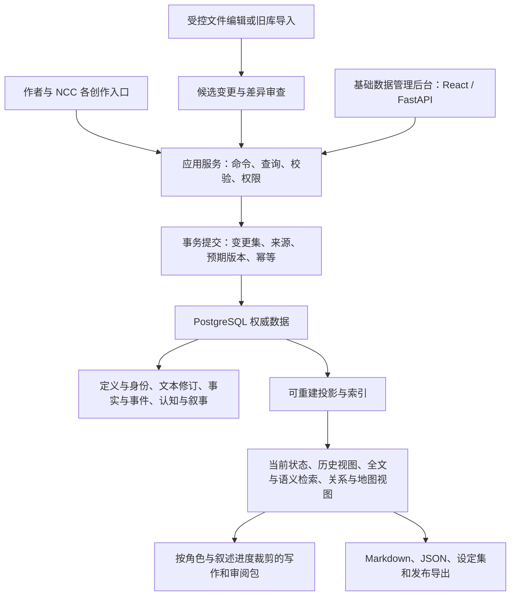

# PostgreSQL 小说知识与叙事底座设计

> 2026-10-19已按作者授权进入实现。本文保留设计依据；其中“本轮仅设计/尚未实施”的叙述属于2026-10-18设计阶段，现行代码、能力与未验边界以[实施计划](implementation.md)、[使用指南](../../guides/data-console.md)和[实施证据](../../evidence/2026-10-18-postgresql-design/implementation.md)为准。

状态：设计候选，待作者审核，未实施。日期：2026-10-18。适用基线：ncc-workflow 3.2.0，提交 `de8d1ab` 及当前任务登记的工作树。关联[设计任务](../../tasks/2026-10-18-postgresql-design.md)。本稿讨论机制、领域清单、操作流程、迁移和验收；不包含数据库表结构、建表语句或实现代码。

配套的[基础数据管理后台设计](management-console.md)采用作者指定的 Python＋FastAPI，并选用 React＋TypeScript＋Ant Design，细化页面、动态表单、变更采用、关系/时间/叙事操作、权限、任务、部署与验收；后台纳入试点切换前的交付条件。

追加的[创作自动化与AI内容评分](creation-automation.md)规定简洁创作入口、系统自动编排、作者随时编写/修改/接管，以及按内容类型评分、有限返修和授权采用。三稿共同审核；本稿的内部数据机制不转换成作者必须逐项操作的流程。

## 1. 目标、范围与审核前提

目标是建立以 PostgreSQL 为权威存储的小说知识与叙事底座：既保存人物、地点、资源和组织，也保存卷章、纲要、正文、事实、认知、伏笔、版本及来源。新增“异火、命格、蛊虫、星域航道”等内容，应能通过受约束的类型与定义扩展承接；不因暂时没有使用界面而删除所需机制。

本方案采用以下推荐前提，作者可在文末审核：

- 结构化信息与正式文本修订均由数据库承载；Markdown、JSON、JSONL 是导出、编辑工作副本或受控导入载体。
- 现有文件模式继续工作，先试点、后迁移；作者确认切换前，不改变任何真实书库的事实来源。
- 小说内容、资料和个人设定进入私有数据域；插件的角色职责、创作闸门和运行规则继续由仓库维护。
- 所有列出的领域都进入覆盖范围。分期交付的是具体业务工具和可视化，不是取消未来需要的身份、时间、版本、权限或引用机制。
- 本轮只审核设计。数据库版本、部署位置、连接凭证、物理容量和表结构在批准后另作实施盘点。

“全部存入 PostgreSQL”首先意味着数据有统一身份、可追溯版本和一致的事务管理。正文不是只能挂一个文件路径，地图也不是只有一句描述。对于图片、音频、地图底图等附件，本方案默认允许数据库保存受管原件；如未来选择外部附件存储，必须保留同样的身份、内容校验、权限、版本和备份清单，不自动改变权威归属。

审核通过的产物应是：明确的对象语义、扩展规则、读写契约、覆盖清单、迁移顺序和可验证的完成条件。通过设计不等于通过实现，更不等于已经迁移。

## 2. 对原方案的复核与修正

原方案的类型注册、定义约束、关系独立、身份稳定和历史可回溯方向应保留。但以下绝对要求需要调整，否则容易在实现时锁死。

| 原主张 | 本方案的处理 | 理由与实施约束 |
|---|---|---|
| 新概念不逐个建专用表 | 采用稳定核心、受约束的领域定义、类型化扩展和专用读模型 | 避免每种丹药一套结构，也避免所有内容都退化成无约束的属性和值 |
| 所有东西都靠动态类型 | 动态扩展适用于领域；身份、事务、文本修订、审计、权限等有稳定内核 | 作者新增“异火”不应修改程序；新增一种全新的计算语义，可能需要受控升级内核 |
| 世界时间和“第几章写进去”组成双时态 | 明确区分世界有效时间、系统记录时间、叙述位置、文本版本与发布快照 | 倒叙章节不是世界时间；第120章也不是数据库记录时间 |
| 一切状态只能靠事件 | 世界变化用事件及事实历史；正文用不可变修订；定义用版本；当前状态可保存为投影 | 不把改错别字虚构成故事里发生了一件事，也不要求每次查询从第一条事件重放 |
| 宇宙、系列、书、用户、系统组成五级主权 | 分开管理内容范围、所有权与访问权、定义包来源、正史和分支 | 宇宙并不天然高于作者权限，书也可能引用多个共享世界模块 |
| 所有关系支持软引用 | 确认关系使用可验证的稳定引用；未解析内容进入显式待解析引用 | 不能以扩展性为由放弃完整性，也不能把同名对象直接视作同一实体 |
| 组织结构用树 | 树是组织关系的一种视图，底层允许带时间和角色的多重隶属 | 军队兼有行政与战时指挥；卧底的表面归属与真实效忠不同 |
| 新增能力只准改数据，不准改代码 | 新增已有语义下的类型、属性、关系和规则配置主要改定义；新算法和基础值类型允许受控开发 | “星域航道”可注册；新的时空距离算法不会因新增一条定义而自动出现 |
| 知识状态是一个状态枚举 | 信念态度、确信程度、信息来源、真假判断分开 | “否认”是表达态度，不一定是不知道；“未知”也不是一种弱置信度 |
| 有全文/向量/图谱预留就够了 | 必须同时定义索引更新、版本失效、权限过滤、查询范围和质量基线 | 一个索引可能能搜到内容，却搜到旧版、别书、未来剧情或无权读取的内容 |

本方案保留全部未来方向，同时为“新增内容”“新增约束”“新增算法”“新增基础能力”划清升级边界。未来可扩展不等于可以跳过变更管理。

## 3. 总体架构与事实来源

系统分成五个职责层，不按每种玄幻名词划分基础设施：

1. **定义层**：类型、能力组合、属性、关系、值域、单位、验证规则和定义版本。
2. **内容层**：对象身份、名称、来源资料、卷章和正文修订、设定片段及附件。
3. **事实与历史层**：断言、世界事件、作者修正、证据、认知、揭示和正式采用记录。
4. **应用层**：写章、审稿、设定维护、伏笔管理、资源流转、组织管理和跨书采用。
5. **查询与交付层**：当前与历史投影、检索、写作包、图谱、地图、设定集和导入导出。

PostgreSQL 保存权威资料；全文、向量、关系闭包、当前状态和可视化数据属于可重建的查询投影。查询投影必须说明自己覆盖到哪个已提交版本，不能凭“文件存在”或“索引存在”证明新鲜。

一个数据范围同一时刻只能有一个权威写入后端。文件模式和数据库模式可以在不同书项目并存，不能对同一本书进行没有事务保证的独立双写。

管理后台与CLI共用应用服务、规则和事务回执。后台不是数据库物理表的直接编辑器；定义配置、世界事件、作者纠正、正文修订及共享采用分别提供正确的操作入口，具体见[后台操作与接口](management-console.md)。

作者可用一句创作/修改目标发起任务，由编排服务串联上下文、生成、审查、评分、返修和资料同步；专业管理工具供主动查看与处理例外。AI成果有版本绑定的分项/总分与依据，评分/授权/硬缺陷状态分别判断。

## 4. 类型与定义：怎样新增领域而不推翻底座

### 4.1 先区分对象性质

至少区分：具体对象、概念/物种、可重复的规格或配方、状态事实、事件过程、规则、叙事节点、来源文献、文本片段。它们可以关联，但不能只因都有名称就使用相同的行为语义。

例如“青霄剑”可能指一种制式武器，也可能指主角手中那一柄；“聚元丹丹方”“三品聚元丹”“本次炼制批次”“某一枚丹药”也不是同一个对象。角色具有“人族身份”“剑修职业”“渡劫境状态”“某神位的任职”，不应强制四选一。

类型使用受约束的组合机制：一个飞舟可同时具有器物、交通工具、容纳空间、消耗资源等能力；一只器灵可同时是有意识生命和法宝关联体。分类继承必须无环，冲突属性必须显式解决；不能靠任意多继承制造含义不明的“万能实体”。

### 4.2 新增类型的实际步骤

以“异火”为例：

1. 查现有类型，确定它是现有火焰类别、力量媒介还是独立有意识生命，避免重复注册。
2. 选择可组合能力，声明可用属性、可建立关系、生命周期和适用世界。
3. 明确性质与品阶、温度或其他强度口径、吞噬条件、代价、失控后果、认主关系等定义；没有证据的值保持未知。
4. 为每个要求提供正常、缺项、错误引用、冲突、未知和变更样例。
5. 发布一个不可静默覆盖的定义版本，旧对象继续绑定旧版本。
6. 新建异火实例；归属、认主、位置和强弱变化分别作为关系或事实变更提交。
7. 根据实际查询需求选择索引与显示模板。没有专用界面也能经过通用入口创建、查询和导出。

新增“蛊虫、命格、星域航道”遵循相同步骤。已有值类型与验证算子足够时，主要修改定义；若需要新的空间计算、模拟机制或第三方解析器，单独登记能力实现，不能把“可存储”冒充“可推演”。

### 4.3 属性定义需要表达的约束

定义应说明语义名称、稳定标识、适用类型、值类型、是否允许多值、是否随时间变化、必填条件、单位和值域、引用目标、缺失含义、默认值策略、验证规则、索引需求及定义版本。

值类型包括文本、精确数值、布尔、分类值、区间、数量与量纲、日期/历法表达、空间表达、稳定引用和受限复合结构。未知、不适用、未采集、明确不存在和存在争议应能区分；不能全部解释成空值或零。

默认值主要用于编辑和候选初始化。没有作者采用或文本依据时，不能把默认值当成世界事实；例如缺少寿元不能默认“永生”，没有金额不能默认零。

属性改名保留标识。属性改含义、改量纲、改基数或从文本变为引用，必须发布新定义版本、输出影响清单，并选择兼容读取或迁移；不能直接让旧值按新含义解释。

### 4.4 物理承载的方向与边界

推荐稳定核心使用明确的关系约束，题材扩展使用定义绑定的类型化数据及适当 JSONB，重型查询使用独立读模型。关键身份、确认引用、版本和权限不能只藏在任意 JSON 字符串中；独立变更的对象也不应全部塞入一份“全书大 JSON”。PostgreSQL 支持关系与 JSON 组合、JSONB 索引，但 JSONB 更新仍涉及所在行的锁，其灵活性不等于自动拥有领域约束。[PostgreSQL JSON 文档](https://www.postgresql.org/docs/current/datatype-json.html)

不采用纯粹“对象—属性名—任意文本值”的无限拆分，也不为每种名词制造一套核心模式。具体物理承载在本设计审核后，根据查询与完整性要求再确定。

## 5. 身份、名称与对象合并

每个对象有独立于名称、路径、卷章编号和显示顺序的稳定身份。可使用无业务含义的全局唯一标识；具体编码不在本轮冻结。

名称属于对象的称呼记录：正式名、别名、尊称、化名、马甲、译名、旧称可并存，并说明语言、使用者、语境、世界有效范围及揭示范围。不能通过名字相同自动合并对象。

“胡爷是林舟”应进一步区分：客观同一身份、某角色猜测同一身份、公开伪装成同一人、作者尚未确认的候选。前三者具有不同的事实与认知作用。

合并流程：列出两个身份的来源、冲突属性、关联对象和已发布使用处 → 作者或授权人员确认 → 产生可追溯的等同/合并决定和旧标识重定向 → 更新投影 → 保留历史引用原貌。误合并应能拆分并重做引用判定；不能删除旧身份后批量猜测归属。

同一法宝的改名、易主和受损通常不改变身份；重铸究竟延续原物还是创造新物，按本世界规则和作者决定记录。副本、赝品、分身、转世、化身、不同时间线对应体均应能表示，不能默认全是同一实体。

## 6. 内容范围、所有权与共享

把以下问题分别回答：谁拥有和能访问数据；它适用于哪个宇宙/系列/作品；它来自哪个定义或素材包；它在哪条正史/分支有效；当前作品采用了哪个版本。

### 6.1 各类范围的职责

| 范围 | 保存什么 | 采用规则 |
|---|---|---|
| 系统定义包 | 通用类型模板和基础值语义 | 版本化安装；不能覆盖作者已采用的含义 |
| 作者/团队资料域 | 私有素材、通用设定、偏好和方法 | 默认不等于任何作品的正式设定 |
| 共享宇宙 | 跨系列共享规则与身份 | 经授权引用具体发布版本 |
| 系列 | 连续作品的共享设定、历史和引用 | 作品明确采用，不按更新时间自动升级 |
| 单书 | 本书正史、章节、特有设定和采用决定 | 默认写入目标，发布内容冻结其引用版本 |
| 分支 | IF线、候选改写、试验设定 | 绑定基线，未合并不影响正史 |

这些是内容与采用范围，不是一个无条件覆盖链。一个作者可能管理多个宇宙；一部书也可能引用多个资料包。冲突需要明确的采用或覆盖决定，不能用“书层总是覆盖一切”偷偷改共享事实。

### 6.2 跨书引用的三种操作

1. **引用**：仍是共享对象，固定其来源范围和采用版本，更新需显式确认。
2. **改编**：创建本书身份，保留“改编自”来源，不让本书变化回写原对象。
3. **共同维护**：作者/团队具有共享对象的编辑权限，但修改仍先形成新版本，各作品分别选择升级。

已确认引用必须验证目标存在、允许访问、类型相容且版本可读取。尚未导入的外部对象使用明确的未解析引用，显示缺项并等待解析；不得悄悄变为正式外键关系，也不得按名称自动命中另一本书的人物。

撤销共享权限后，后续查询与重新导出应遵守权限；已经合法冻结的作品快照如何保留，须在采用协议中约定，不能临时把合法历史引用全部打坏。实现时需要明确快照保留与撤回策略。

## 7. 时间、文本修订、正史与分支

### 7.1 至少分清四个坐标

| 坐标 | 回答什么 | 示例 |
|---|---|---|
| 世界有效时间 | 故事中何时成立 | 青岚历三年春到五年冬，剑归甲持有 |
| 系统记录时间 | 数据库何时接受这个说法或修正 | 作者今天才录入，明天又修正 |
| 叙述位置 | 读者按哪一版正文读到何处 | 某版第120章第三场发生回忆或揭示 |
| 修订/发布快照 | 使用哪一份正文、设定和定义集合 | 修订版R2、首次连载快照、再版快照 |

严格的双时态核心是世界有效时间与系统记录时间；叙述顺序和文本版本另外关联。一个完整查询还必须指定作品范围与分支。章节位置不能代替系统时间，也不能普遍代替世界时间。

“第120章时的境界”有三种不同问法：第120章当前场景所处的世界时刻是什么境界；读到该章时读者知道什么；作者当年写到该章时认为设定是什么。入口应提示采用哪种口径，而不是返回一个看似精确的“当前值”。

### 7.2 虚构时间的表达

支持自定义历法、纪元、时间区间、相对顺序、约略时间、尚不确定的边界及“甲事之后、乙事之前”。没有绝对日期的作品不能被强制转换成现实公历。

可精确排序的时间区间采用统一的边界约定，推荐起点包含、终点不包含；不明确的边界保留不确定性，不强行填开天辟地或无限未来。局部时间流速差异需要适用区间和转换依据，不能给整个位面永久套一个未经确认的倍数。

PostgreSQL 范围类型及排斥约束可支撑“在同一限定范围不允许重叠”一类规则；自定义历法、模糊时间和因果先后仍需领域解释，不能直接宣称数据库天然理解故事时间。[PostgreSQL 范围文档](https://www.postgresql.org/docs/current/rangetypes.html)

### 7.3 不同版本不能混为一谈

分别记录：类型定义版本、对象/事实修订、正文修订、正史基线、分支基线、发布快照、投影算法版本和嵌入模型版本。一次正文改动可能只影响排版，也可能改变一个事实；系统须给出影响，不能强制把所有对象版本同步加一。

章节拥有稳定身份，卷号、章号、排序和标题是可改的编排。插章、换卷、拆章、并章后，原审稿证据与旧发布引用仍指向旧版具体片段，不能随着新章号错位。新旧片段之间保留可复核的映射，映射不确定时待人工处理。

### 7.4 正史与分支

创建分支时固定“从哪个正史版本、定义版本和共享引用版本分出”；分支保存自己的变化，不读取父分支后来的漂移。查询必须在一个明确的分支上下文内解释事实。

分支合并采用基线、目标、来源三方比较：互不影响的内容可合并；相同对象、重叠有效区间内的不相容断言必须列冲突；同名新人物不自动合并。合并结果形成新的正式修订，并检查下游章节、伏笔、引用和评审失效。

“试演结果”仍是分支或推演候选。分支存在不等于具备自动模拟引擎，模拟引擎也不能自行晋升结果为正史。

### 7.5 一次历史查询的解析顺序

先验证实际操作者对作品与共享资料的权限 → 固定作品采用版本、正史/分支基线和目标文本修订 → 选定世界时点及系统记录截止 → 解析该范围已批准的事实与更正 → 处理并存/冲突及定义版本 → 检查投影是否覆盖本次基线 → 根据执行角色、人物认知与读者叙述截止裁剪 → 返回结果和依据。

未指定的上下文可以采用项目当前绑定，但必须在结果中说明；不得在一次查询中把“最新正文”“旧版设定”和“另一本书的当前共享对象”任意拼接。结果应区分已确定、不确定、多种说法、未观察和无权查看；查询不到不自动等于不存在。

例如查“第120章青霄剑归谁”，先用该正文修订的场景确定世界时间；若同章有两段不同年代的场景，应分别返回或要求选择场景，不能随意取章尾当前状态。

## 8. 事实、事件与当前状态

### 8.1 区分四类内容

- **作者规划**：准备让主角第50章突破，尚未在故事中发生。
- **事实断言**：在特定世界时间和版本下，主角处于某境界；断言有来源与采用状态。
- **世界事件**：主角完成突破、法宝发生转移、宗门解散等故事中的变化。
- **作者修正**：作者今天认定旧稿的突破时间写错，修订已采用断言及受影响文本。

事件记录参与者、角色、过程、条件、结果及来源，可以造成多个事实变化。事实采用状态与证据置信度分别管理：作者正式决定、正文明确陈述、人物传闻、模型推断不是同一类权威。高置信推断不会自动覆盖作者决定。

所有事实没有必要都虚构一个故事事件。“此山历来高三千丈”可以作为带来源的初始断言；后续若山体崩塌，再记录真实世界事件。导入旧库缺少历史时明确标为“导入基线，之前历史未知”，不补造过去。

### 8.2 写入一项变化的完整流程

以“第120章，甲将青霄剑交给乙”为例：

1. 固定作品、分支、正文修订、故事时点与本次操作的预期版本。
2. 校验双方和剑的稳定身份、现有归属、转移条件及物品类型；区分所有权、保管、借用和实际控制。
3. 产生候选变化，给出前后状态、依据及对已有章节/规划的影响。
4. 在授权范围内确认后，用一个事务写入世界事件、事实/关系变化、来源、审计及后续索引任务；重复请求使用同一幂等标识。
5. 关键状态投影与一致性标记一起更新；重型检索任务可以稍后完成，但必须暴露尚未追平的版本。
6. 查询“第119章场景”和“第121章场景”得到各自状态；按旧稿快照查询得到当时已知结果；分支中的另一次转移不污染正史。

并发编辑采用预期版本校验。涉及独占归属、资源扣减或关系区间冲突时，必须在事务内完成检查与提交，并正确处理并发重试，不能先查后写而留下竞争窗口。[PostgreSQL 事务隔离](https://www.postgresql.org/docs/current/transaction-iso.html)

### 8.3 投影与回放

当前状态、历史快照和统计允许保存，但必须绑定事实/事件范围、定义版本及投影算法版本。投影能删除后重建，不能作为另一套独立写入源。

回放从已校验快照和后续变更开始；旧版事件解释规则必须仍可读取，或经过明确的版本转换。投影重建不得依赖“再问一次模型”得到同样答案，模型当时产生的候选与最终采用结果应已保存。

同一时点冲突的事实保留完整断言与来源，进入冲突处理；不能后写覆盖，也不能先写者永久获胜。可以明确采用一条、限定适用范围、声明并存或继续待定。冲突告警须说明影响哪些查询，不能把整本书无差别停写。

### 8.4 Retcon 的实际处理

作者提出修正 → 检索受影响的事实、事件、正文片段、共享采用、伏笔与角色认知 → 生成差异和影响范围 → 确认修正方式与适用版本 → 保存更正、撤销或替代关系 → 重建相关投影并使旧评审/包失效 → 再验收新内容。

旧版本继续可查。若既有正文和新设定尚未同步，显示“已批准修订、文本待修”，而不是宣称所有历史都已经一致。已发布快照不因当前设定修改而被悄悄重写。

## 9. 关系与组织：不把世界压成一张树

关系定义需要说明参与对象的类型、各自角色、方向或对称性、允许基数、有效区间、适用世界与分支、公开口径和来源。强度可作为某些关系的度量，不要求每个关系都凭空打一个分数。

二元关系适合“甲师承乙”；多方事件或协议必须允许多个参与角色，例如买方、卖方、担保人、见证人、标的和支付物。不能靠拼接多个没有共同身份的二元关系丢失“这是同一次交易”的语义。

对方向、对称、传递、循环和互斥分别配置：血缘与正式指挥链可要求无环；敌对关系、资源流动和情报网可以有环；“属于同一宗门”不自动推出“互相知道真实身份”。

### 9.1 组织的构成

分别表示组织本体、组织单位、职位、职级、任职、成员资格、驻地和辖区。组织结构是这些对象在某个故事时点、某版正史里的关系投影。

例如同一军队可存在行政隶属、作战指挥和后勤保障三条关系；一位将领可同时有军衔和临时职务。宗门堂口可隶属总坛，又接受长老的专项指挥。卧底可表面属于甲、秘密效忠乙。不能用一个 parent 或当前职位覆盖全部关系。

任职绑定世界有效范围及正文依据；有明确章节时关联具体片段，没有章节也可来自历史设定。未知起点和结束点不能伪造为第1章和大结局。章序重排后，任职历史仍然有效。

### 9.2 组织规则需要可配置的部分

- 一个职位是否允许多人兼任、代理、空缺或轮值。
- 一个成员能否跨单位任职，哪些职务互斥。
- 是否允许分裂、合并、改名、灭亡后重建，以及是否延续原身份。
- 正式隶属、实际控制、经济依赖、盟约与暗中渗透如何区分。
- 哪些组织关系公开，哪些只是传闻，哪些由作者确认但角色尚不知情。

必须能查询“此时名义上谁负责”“实际上谁控制”“某角色以为谁负责”，并分别列出证据和不确定处。

## 10. 客观事实、角色认知与读者信息

### 10.1 认知必须针对具体命题

不能只记录“甲知道乙”。需要指向一个可引用命题，例如“青霄剑的真实持有人是乙”，再描述甲如何看待该命题、确信程度、来源、获知时间和变化。

分别管理：

1. 世界正史是否采用该命题，或其真相是否尚未确定。
2. 角色是否接触信息、相信、怀疑、误信、忘记或暂时无法使用信息。
3. 角色如何对外表达：承认、否认、撒谎、隐瞒、沉默等。
4. 读者在某一正文修订的具体位置获得了什么明示信息或可推断线索。

“不知道”需要区分明确设定其不知情与系统尚未采集该角色认知。未查到记录不能一律证明角色不知道。模型推断的读者理解也不能直接当作读者已确认掌握的事实。

### 10.2 信息传播与知识变更

角色通过目击、告知、阅读、推断、占卜、读心等途径获知信息，必须记录途径与依据。遗忘、失忆、封印和误导可以改变其认知可用性；公开传播事件不自动让全宇宙所有人物都知道。

推断属于有前提的判断，前提被修订时应产生影响提示。复杂推理可记录已采用的推导结果及依赖，不承诺只注册一条类型就获得通用逻辑推理能力。

### 10.3 四种可见性不能共用一个“隐藏”开关

| 可见性 | 管理的对象 | 例子 |
|---|---|---|
| 用户访问权限 | 真实作者、协作者和外部应用 | 协作者能否读取这部书 |
| 故事中的公开性 | 世界里的公众口径 | 宗门公开宣称敌对，实际秘密结盟 |
| 角色认知 | 特定人物在故事时点的认知 | 主角尚不知道师父身份 |
| 读者揭示 | 某版正文读到的位置 | 第80章揭示给读者，第100章才告知主角 |

NCC 的执行角色可见性另外由现行角色规则控制：写手不拿审稿清单，盲读者不拿创作规划；这种规则不会因为数据进库而失效。

### 10.4 连续性检查的输出

对于“甲在第60章使用了第90章才获得的信息”，检查应返回：命题、甲的获知记录、正文位置、两者对应世界时间、版本和可能的合法解释。存在倒叙、可靠的更早来源或作者保留的悬念时，不机械判错；缺资料时报告无法判定。

知识泄露只能在观察范围和时间口径明确时检查。关系、向量相似度或一个猜测性的别名，不能直接证明人物拥有某知识。

## 11. 卷章、大纲、细纲与正文的共同管理

### 11.1 叙事节点和正文修订

作品、卷、章节、场景、叙事节拍、段落/片段都有稳定身份和各自修订。大纲、卷纲、细纲、场景卡和正文之间建立“计划、实现、偏离、替代、引用”的关联，不把纲要内容自动当成故事已经发生。

正文以可重建的不可变文本修订保存；可以同时维护便于阅读的完整文本和差异索引。片段锚点同时绑定文本修订、位置与内容校验，短定位词作为人读证据，不能单独作为唯一定位依据。

插章、删段、并章后，先对账受影响的锚点和节点映射；不能只改序号就认为伏笔和审稿证据仍然指向原文。旧发布版的文字和锚点仍可查询。

### 11.2 叙事节拍与剧情线

支持主线、支线、人物弧、关系线、暗线、母题、主题、契约承诺、悬念和预期兑现。节拍可描述功能、强度口径、位置、视角、情绪目标与涉及对象；作者可扩展标签，无法判断的内容保持候选。

同一剧情片段可以服务多个线索，但每条关联需说明作用。强度数字是作者定义的观察尺度，不包装成作品质量的客观分数。

### 11.3 伏笔生命周期

分别管理规划中的伏笔和已经写入文本的伏笔。建议支持：待埋、已埋、强化、部分兑现、完全兑现、明确撤回/放弃、已有补偿，以及待修订失效。一次回收可以兑现多条伏笔，一条伏笔也可能跨多次兑现。

每次埋设、强化、兑现都要关联具体正文修订和片段，并可说明关联的命题、读者预期、目标角色与预期窗口。规划中的“计划已写”与正文中“确已埋下”必须分开核实。

“连续N章未提及”只对选定发布/正文编排中已连续观察的章节计算，阈值按本书或线索配置。缺章、稀疏抽样、尚未分析的章节显示覆盖不足；长期埋伏可以有作者保留理由。告警提供最后观察点、间隔、期望窗口和覆盖范围，不自动宣判作者忘记。

### 11.4 创作编排、审稿与评分

先审场景，再写正文；正文变化后旧审稿结论仅适用于原修订。数据库保存评审对象、证据版本、角色与结果，不能把一条“通过”跨版本复制。

写手包固定本次作品/分支、正文修订、场景卡、可见事实、读者此刻、采用的技法、定义/规则版本和来源清单。若依赖发生实质变化，提示包过期并重组，而不是在模型执行中途静默替换上下文。

作者日常只需提出目标、查看成果/评分并采用或修改；准备、故事审、生成、事实检查、评分、有限返修、台账及索引更新由系统自动编排。作者主动编辑时生成新修订，运行中的旧AI结果不能覆盖；需要作者决策的影响集中处理，明确授权内不重复确认。

正文、纲要、设定、抽取及修订分别采用P1–P5质量方案，分项依据和总分进入版本化报告；新修订或关键依赖变化使旧评分失效。初始推荐85分达标、70–84.9分返修、70分以下重构，并设关键维度底线、严重硬伤阻断、证据完整性与有限预算；详细规则唯一见[自动化评分设计](creation-automation.md)。权重/阈值须校准，当前未实施。

现行CLI品质层不打绝对分，新方案按作者要求增设评分与自动路由，保留硬伤/故事检查和关键候选比较。启用前同步相关技能、角色、registry和工具契约并执行对应行为验证；本轮只改设计，不在后台单方面跳过现有闸门。作者直接采用或有效托管策略为正式提交提供授权依据，生成者自评不构成授权。

## 12. 领域覆盖与补充清单

以下是概念和能力覆盖清单，不是数据库表清单。全部纳入类型、事实、关系和文档机制的承接范围；可以没有实例、界面或模拟器，但不可在实施中无记录地删去类别。

### 12.1 世界法则、约束与代价

包含天道/自然法则、位面局部规则、豁免、禁忌、契约、因果、气运、命格、功德、业力、轮回、天劫、雷劫、心魔及世界的时间/空间/生死规则。

每项需要能表达适用范围、前提、过程、例外、代价、触发与终止、违约后果、来源和揭示。规则的代价不能只写“付出代价”，须能关联寿元、资源、记忆、情感、气运等具体变化；没有说明的内容标未知。

作者法则、角色相信的法则、宗教教义和社会传说分开。例如“渡劫必死”可能是民间误解，不自动成为宇宙法则。

### 12.2 宇宙、位面与跨界通行

包含宇宙、维度、位面、世界、星域、星系、天体、界壁、虚空、时空裂隙、秘境、洞天、小世界、洞府空间、随身空间、传送阵、界门、星门和星域航道。

需要表达包含、相邻、连接、规则差异、开放时段、通行条件、方向性、代价、耗时、容量和危险；同一通道在不同时期可能失效。空间容器的内部地点与外部携带位置分开，不能把随身洞府内的城池永久钉在外界坐标上。

### 12.3 地理、地图、自然与生态

包含大陆、海域、河流、山脉、地形、气候、季节、昼夜、月相、潮汐、天象、灾害、灵脉、矿脉、灵田、药园、灵泉、地火与风水，以及栖息、天敌、共生、迁徙、资源再生和污染。

地图允许仅有拓扑和相对方位，也允许局部二维、三维、天体与跨位面坐标。每套坐标必须说明参照系、原点、单位、精度、有效时期和来源；虚构世界不默认使用现实经纬度。行政边界、势力控制区和物理地理边界可以不同。

距离有直线、实际路线和传送代价等口径。只有在坐标可比较且路网/规则充分时才计算耗时；不能把“两个点相邻”当作随时可通行。

### 12.4 生命类型、种族与个体

包含人物、种族、族群、血脉、人、鬼、神、仙、妖、兽、精怪、神兽、异兽、凶兽、魔物、亡灵、灵虫、灵植、召唤物、灵宠、坐骑、傀儡与器灵。

区分物种、血统、文化身份、生命形态、修为状态、神职和个体。某作品里的“仙”可能是境界，另一作品是种族；某“神”可能是职位而非生命类别。通过定义包适配，不把这些含义写死成互斥种族枚举。

支持繁衍、变异、附身、夺舍、分身、转世、人格共存、变形及生死状态。灵宠与主人是关系，不能成为该生命唯一身份。

### 12.5 人物、身份、关系与人物弧

包含姓名/称谓/马甲、年龄与寿元、外貌、动机、目标、恐惧、欲望、秘密、弱点、习惯、口癖、语言风格、伦理立场、人物弧与行动选择。

关系包含血缘、师承、道侣、仇敌、盟友、主仆、契约、暗恋、误会、辈分与称谓。伤势、中毒、诅咒、心魔、情绪、立场、认知与资源状况作为有时点的状态，静态底卡只是选定时点的视图。

心理判断区分作者决定、人物自述、他人评价和模型分析，不能将一次行为推断成永久性格事实。

### 12.6 力量、修炼、经脉与能力

包含境界/等级/品阶、灵根、体质、天赋、经脉、穴位、丹田、神魂、属性/元素、克制、功法、招式、神通、法术、身法、剑法、刀法、拳掌指法、瞳术、音功、阵法、符箓、禁制、领域与法则感悟。

覆盖正道、魔道、佛道儒修、妖修、鬼修、体修、剑修、丹器阵修、御兽、炼尸、傀儡、蛊术、诅咒、卜算等流派；新流派可注册。支持修炼进度、瓶颈、突破条件、失败后果、走火入魔、功法残缺/补全、冲突、传承及使用限制。

境界比较要绑定所属体系，跨体系不能只比较名称或数字大小。战斗结果还涉及场地、状态、资源和策略；保存这些条件为未来推演提供依据，当前不能把境界排名冒充确定战斗结论。

### 12.7 器物、装备、交通与特殊资源

包含道具、武器、法宝、灵宝、本命法宝、飞舟、载具、器灵、异火、套装、铭文、阵纹、附魔、材料、机关、暗器、阵盘、符箓和傀儡造物。

区分规格、独一实例、数量库存和制造批次；支持认主、祭炼、持有、所有、保管、借用、抵押、租赁、遗失、损毁、修复、重铸、复制、仿制、赝品与鉴定结论。鉴定说它是真品与作者认定它是真品分别保存。

飞舟可以拥有内部空间、承载能力、航线、运行资源和船员；不把飞舟仅当一个人物背包里的物品名。

### 12.8 丹药、毒蛊、配方与制造过程

包含丹药、丹方、药材、灵植、丹炉、异火、火候、步骤、丹成异象、品质、药效、持续时间、耐药性、丹毒、副作用、解药、毒物与蛊。

丹方是规格/知识，炼制是过程，成品可形成批次和单体。记录配料数量、量纲、替代条件、成功/失败、损耗和产出，区分作者配方、传闻配方和试验结果。药效具有适用种族、境界、状态与叠加规则，不能保存成一个脱离条件的“恢复值”。

### 12.9 经济、货币、库存、贸易与生产

包含货币、灵石、魔晶、仙晶、贡献点、功德点、票据、钱庄、价格、交换比率、佣金、税费、黑市、拍卖规则、商路、商队、产地、产量、稀缺性、垄断和产业链。

数量必须带资源/币种、计量单位、精度和适用范围；用精确数值表达金额，不能用浮点近似累积货币。相同名字的灵石在不同世界不一定等价；汇率按时地、品级、兑换方向与手续费限定，不能全书只留一个兑换倍数。

精确比率可保留分子/分母，不将三分之一直接截成小数；换算到实际数量时明确目标精度、舍入规则和余量归属，原比率与结果分别可追溯。后台控件与API采用同一契约，避免浏览器数值精度损失。

库存变化关联取得、转移、消耗、生产、损毁或创造事件；规则允许的凭空创造也要有依据。债务、报酬与已支付分开；计划买到不等于已经持有。

支持度量衡、历法和纪元，但它们是基础量纲/时间机制，不能只藏在经济附注中。

### 12.10 国家、宗门、帮派与其他组织

包含国家、王朝、帝国、部落、联盟、国家组织结构、宗门、魔门、堂口、帮派、家族、军队、商会、镖局、情报/刺客/地下组织、佣兵团、学院、书院、寺庙、道观与隐世/上古族群组织。

覆盖官制、爵位、职位、权限、职级、选拔/晋升、派系、长老会、议会、军衔、编制、兵种、番号、驻地、辖区、附庸、朝贡、联姻、盟约、世仇、渗透与战争状态。

“武官”表示官职或任职者，“武馆”表示机构/场所；保留二者，不能把原始清单中的近形词直接归并。堂口既可能是组织单位，也可能有具体驻地，组织身份与建筑地点分开。

国家、军队、宗门、魔门、帮派、武馆与堂口的组织结构共用关系机制，同时保留各自的权力与任职规则。

### 12.11 制度、文化、社会与历史

包含法律、刑罚、税制、科举/选拔、门规、帮规、军法、等级/阶级、奴隶制度、信仰、宗教、语言、文字、方言、礼仪、婚丧嫁娶、节日、神话、传说、预言及文明演变。

制度区分成文规则、实际执行、适用身份、例外和某角色的理解；历史区分客观事件、官方史书、族群传说和被篡改的说法。新增制度必须能解释利益、权力、资源与冲突，不能只有一个名称标签。

### 12.12 地点、建筑、经营场所与地标

包含城池及位置、村镇、关隘、要塞、宫殿、府邸、洞府、遗迹、古墓、战场、擂台、试炼场、禁地、封印地、港口、码头、驿站、坊市、黑市、酒楼、客栈、拍卖行、丹坊、锻造坊、御兽坊、符坊和阵坊。

地点可存在繁荣、废弃、被占领、移动、封印、摧毁和重建等状态。经营组织、经营行为、建筑和地理位置分别关联：拍卖行换主人不一定换地点，飞舟上的丹坊也不是永久固定建筑。

### 12.13 思想、典籍、语录与现实参考

专门承接佛家、道家、法家、墨家及其他思想流派的典籍、命题、概念、语录、注疏、译文、人物和争论；不把它们挤进人物“口癖”或世界“法则”。

每段原文需要书目、作者/归属、版本、卷篇/页码或稳定定位、语言、原文、译文/注释来源及可核实状态。流派归属、语录真实性、作者归属和不同版本差异分别判断；同一句话在多个流派被引用不是多个互斥身份。

作者解释、模型摘要、原创仿作、改编后的虚构经典和原文分开。没有查到出处时标未核或原创，不能伪造古籍出处。采用到某小说时另建采用关系，允许只采纳思想机制或表达风格；现实教义不自动成为小说宇宙的客观真理。引用与传播方式要保留具体来源和使用限制。

### 12.14 叙事生产与结构

包含作品、卷、章、大纲、卷纲、细纲、剧情、场景、节拍、人物弧、主支线、伏笔、悬念、反转、爽点、虐点、钩子、节奏、母题、主题、基调、视角、人称、倒叙、闪回、梦境、预言、信息差与桥段库。

每类要能关联计划与实际文本、涉及对象、作者目标、采用版本、读者揭示及观察范围。类型标签不替代实际内容，也不自动成为质量分。

### 12.15 创作过程、素材与运营信息

包含灵感、素材、参考资料、准备成果、草稿、废弃稿、修改、批注、审稿、定稿、写作计划、日更目标、字数、存稿、更新计划、标签、题材、风格、目标读者、内容限制、发布状态、平台和读者反馈。

真实读者数据、模拟读者反应、模型评语分别标识来源。平台发布记录不等于系统自动具备代发权限；本方案不顺带实现平台后台或稿费业务。准备资料可以先存在，再被书项目按范围采用，不要求为了存一条语录而先创建主角和大纲。

### 12.16 跨书、共享、分支和后续应用

包含系列、前传、后传、外传、联动、共享宇宙、平行作品、共享定义包、跨书对象采用、多语言与译名、关系图、地图、时间轴、人物卡、设定集、百科、API、协作、AI辅助和模拟推演。

当前机制必须可表达它们的身份、作用范围、基线、授权和来源。专用界面、复杂战斗/经济/生态模拟及公开百科是后续应用能力，不能因尚未实施而删除其所需的基础信息，也不能在没有实现算法时宣称已经支持自动推演。

## 13. 检索、图谱与上下文选择

### 13.1 三种查询能力分别负责什么

- **结构化与关系查询**：按身份、类型、时间、分支、归属、数量和关联路径精确筛选；回答“是谁、何时、与谁有关”。
- **全文查询**：名称、别名、术语、原句与出处检索；回答“哪个文本写过这件事”。
- **语义查询**：概念相近、表达不同的材料召回；回答“哪些内容可能相关”，不直接确认事实真假。

数据库内可以先实现关系查询与有限跳数遍历，不必把单独图数据库作为起步前提。复杂路径搜索、图算法和视图缓存按实际规模增加；每条结果要保留关系证据、限定范围与版本。

### 13.2 中文检索必须单独设计

建设作品专名、称谓、术语、异写与简繁体处理规则；固定分词/归一化版本，并以中文查询样例测召回。原文保持原貌，索引用的归一化文本是投影，不能拿归一化结果替换权威原句。

PostgreSQL 的全文解析器负责分词与识别词元类型；仅启用默认全文能力，不能视作已满足中文小说的人名和术语检索，需要验证词典及切词策略。[PostgreSQL 全文解析器](https://www.postgresql.org/docs/current/textsearch-parsers.html)

精确名称和对象ID查询应有稳定路径；分词或向量索引失效时仍可查指定对象，但不能假装语义检索已经正常。

### 13.3 语义索引的可替换契约

每个嵌入绑定原对象、文本修订、片段、语言、切块策略、模型身份/版本、维度及内容校验。模型、维度、切块或原文变更后建立新的索引版本，不能混用距离分数。

允许数据库内扩展或独立索引服务实现语义索引，但 PostgreSQL 中的身份、权限、出处和文本修订保持权威。具体提供方在后续实施评审选择，不在本轮安装或列为现有运行依赖。向量不可用时明确退化到结构化/全文查询，不把相似文本自动合并成实体。

索引任务采用与内容提交关联的持久任务记录，可重试并去重；失败不丢原始资料，成功也要确认处理的还是目标修订。可删除索引并从权威数据重建。

### 13.4 给模型的查询上下文

查询先固定：真实操作者权限、作品/共享采用、分支、正文修订、世界时点、叙述截止点、执行角色与任务。再筛选可见事实与文本，最后召回、去重、排序和按预算组包；检索结果进入模型前再核对版本与可见性。

不能先把全书未来秘密发给模型，再要求它“不要泄露”。语义索引、摘要缓存、引用提示和读者百科都要使用相同的范围约束。返回项须带出处、事实/传闻/规划类别、置信或采用状态以及适用范围。

## 14. 校验规则与冲突处理

### 14.1 四层校验

1. **基础完整性**：身份、必需上下文、修订、精确值、稳定引用、唯一性和事务边界。
2. **定义契约**：类型、单位、值域、允许关系、基数、必填条件和定义版本。
3. **连续性与依赖**：同一时点归属、角色认知、库存、任职、旅行、规则代价和已发生事件之间是否相容。
4. **创作判断**：人物行为、伏笔公平、情节合理性和读者体验；提出带证据的观察，交原有审稿流程。

能由 PostgreSQL 完整性约束保证的事项优先落实到数据库；依赖动态定义、多个对象和时间上下文的规则由应用服务及必要的数据库机制在事务中执行。不能把跨对象校验包装成读取其他数据的普通 CHECK，并宣称数据库会持续保证其正确性。[PostgreSQL 约束说明](https://www.postgresql.org/docs/current/ddl-constraints.html)

### 14.2 可插拔不等于可任意执行

规则定义需要版本、适用范围、输入、所用算子、严重度、解释模板、样例和成本上限。常见比较、数量、区间、存在性、关系基数可通过受限规则表达；新算法作为受控实现注册，不允许资料内容直接提供任意 SQL 或脚本。

规则运行记录输入版本、结果、证据和无法判断的原因。规则更新先对冻结样例比较差异，再启用新版本；旧审查可以用旧规则复查，不悄悄改成新标准。

### 14.3 冲突不是只有覆盖和删除

处理选项应包括：确认某说法、修正时点、限定范围、声明合法并存、标记角色误信/公众传言、保留多种候选、批准设定修订、明确不适用、撤回错误抽取。

硬性完整性错误阻止正式提交；缺资料和语义疑点形成待处理项。草稿允许不完整，但不能以“保存草稿”为名晋升为已确立事实。显式豁免绑定具体规则、范围、版本和理由，不能全库跳过校验。

## 15. 事务、权限、备份与运行质量

### 15.1 写入原子性与幂等

一次创作动作以一个有身份的变更集提交，包含操作者、目标范围、预期基线、请求标识、变更内容、来源及批准依据。事实历史、正文采用、关系变化、审计和持久后续任务在同一数据库事务内确认，失败整体回滚。

重复导入、网络超时后的重试和任务恢复不能重复扣灵石、再造一个人物或新增一次伏笔兑现。幂等标识限定操作语义和目标范围；内容不同时不能重用同一请求标识假装成功。

对象内版本及变更集记录必要的因果顺序；不能只凭墙上时钟或预先分配的自增序号推断事务提交先后。跨对象读取使用一致的已提交快照，投影前沿必须可验证，不把尚未提交或已回滚的序号空洞当作已处理事件。

对独占归属、库存余额、硬闸门等关键数据要求提交时立即一致。全文、向量、大型图谱投影允许异步更新，但查询必须知道所覆盖的提交前沿；写作包或定稿若要求最新内容，则等待追平或直接从权威版本组装，不能读到混合的新旧事实。

应用不只捕获报错，还要区分校验失败、版本冲突、权限失败、临时不可用和可重试事务失败。自动重试次数有上限，重试整个逻辑事务；不能重试一半扣款、一半发货。

### 15.2 权限与私有内容

区分真实作者/协作者、NCC 执行角色、故事中的人物。作者是应用所有者不等于每个运行进程都使用数据库超级用户；角色组包不得向模型暴露数据库凭证或无限制 SQL 能力。

PostgreSQL 权限和行级安全可作为多书/多用户隔离的一层，但所有者、超级用户等有绕过条件，必须按实际服务角色验证，不能写一句“开启RLS即全部安全”。应用层还需执行作品采用、分支和叙述可见性。[PostgreSQL 行级安全](https://www.postgresql.org/docs/current/ddl-rowsecurity.html)

数据导出仍遵守本项目的私有书稿约束：数据库备份、转储、正文工作副本、检索缓存和私有配置不进入插件 Git 仓库。向外部嵌入或生成服务发送内容，遵从作者选择的服务与授权，不因增加语义索引就默认上传整库。

### 15.3 备份与恢复

开发前先定义“可接受丢失多少数据”和“多久能恢复”。本方案建议：试点正式写作后，目标数据丢失窗口不超过15分钟，单书恢复演练目标1小时内；这是待验证的运行目标，不是已有保证。若部署条件只能日备份，需要作者明确接受对应损失窗口，不能省略说明。

备份必须覆盖权威数据、文本/附件原件、定义版本、共享采用版本、必要密钥与部署配置，并保留可校验清单。索引可重建，原件和已采用事实不能依靠模型重新生成。

PostgreSQL 官方区分逻辑转储、文件级备份和连续归档；实施时按所需恢复点选择方案，数据库能够启动不等于作品和附件已完整恢复。[PostgreSQL 备份与恢复](https://www.postgresql.org/docs/current/backup.html)

恢复演练检查对象/修订数量、内容校验、事实状态、正文原件、引用、角色包及跨书隔离。事件日志和 Git 都不能单独替代数据库备份；备份文件不只放在唯一数据盘上。

常规删除采用可追溯撤回或墓碑；误删可以按授权恢复。确需永久清理私有内容时，另走显式维护流程，覆盖历史正文、索引、缓存和备份保留周期，并留不含正文的清理回执。不能宣称“删一条当前记录”已经从所有副本消除内容。

### 15.4 性能与成本的候选验收目标

先定义两档公开合成负载：单书3000章、千万汉字、5万对象、50万条事实/关系变化；多书档扩大到十倍，并加入至少4个并发编辑/检索会话。这是工程测试规模，不是对作者真实库的假定。

指定硬件、版本、索引、缓存条件和查询样例后，候选目标为：常见单对象/指定时点状态查询P95不超过300毫秒，限定范围的两跳关系查询与中文检索P95不超过1秒。回放、全库对账、嵌入重建单独统计吞吐、内存、磁盘和进度，不拿后台任务的耗时掩盖交互查询。

正式目标在实施探针后由作者确认；若达不到，输出瓶颈、修正方案与成本，不默默删字段、缩小观察范围或把未知写成零来“优化通过”。维护慢查询、任务积压、投影落后、冲突和备份结果等可观察指标。

## 16. 与 ncc-workflow 的接入及迁移

### 16.1 现状与改变边界

当前项目的 `scripts/ncclib/core.py` 直接读写 book.json 和若干 JSON/JSONL 台账；`scripts/ncc_prepare.py` 管理 prepare.json 与准备文件；设定、素材、记忆、正文和视图由各模块及技能读写。拆书新模块以已验收章收据重建台账与进度，但尚不是 PostgreSQL 后端。

因此迁移不能只把 book.json 原样塞进一列，或者只改一个 load/save 函数。要逐项处理正文、角色产物、准备工作区、共享资料、拆书收据、台账、派单包、审核证据和所有读写入口。

本次只调查公开源代码，未读取真实小说目录、数据库或连接凭证。现有拆书代码的待验状态仍有效，不能把数据库方案审核当成其回归完成。

### 16.2 接入后的职责

| 当前部分 | 推荐接入办法 | 保留的边界 |
|---|---|---|
| 新建Web管理后台 | Python/FastAPI与React工作台，调用统一应用命令/查询 | 共用身份、范围、时态与审计；不旁路正史采用和原有创作闸门 |
| 书项目与台账工具 | 通过统一应用服务和存储接口操作作品、事实与事务 | 保留创作命令意图，内部不再直接拼文件写状态 |
| 准备与素材库治理 | 独立资料范围，成果经采用进入作品 | 不要求先建书，不把通用素材直接变正史 |
| 设定与类别 | 绑定可版本化的领域定义包 | 现有类目作为初始映射，不因名称相近自动合并 |
| 正文、纲要、场景卡 | 数据库修订与受控编辑工作副本 | 文本变更必须产生新修订，保持故事审与正文审分工 |
| 创作编排与AI评分 | 根据任务和有效授权自动生成、检查、分项评分、有限返修并同步资料 | 三入口简洁交互；主动介入不丢稿；新评分规则启用前做相应行为验证 |
| 角色派单与写手包 | 从固定版本及可见性上下文组包，生成带清单的工作文件 | 角色规则仍来自仓库，作者书数据来自所绑定后端 |
| 审稿与评测 | 明确绑定正文修订、规则版本和输入快照 | 旧通过结论不跨正文版本复用，盲读材料隔离 |
| 拆书 | 原文、唯一索引、验收收据和事实历史映射到独立研究范围 | 对标书事实与作者作品正史隔离；采用方法需显式操作 |
| Markdown/JSON视图和导出 | 从数据库和固定快照生成，可重建 | 不读取生成视图反向覆盖权威状态 |
| registry/技能/角色规则 | 继续由项目文件与 Git 管理 | 不新增第二套可独立修改的同名全局规则 |

领域定义的运行版本可以安装到私有数据库，但插件提供的系统模板要有来源与版本；升级模板是显式安装与采用过程。作者自定义领域属于数据，不直接回写公共插件的规则源。

### 16.3 存储接口与模块边界

拟建立统一的存储边界，提供范围定位、事务、预期版本写入、文本修订、身份解析、事实查询、分支/时点投影和导出能力；文件后端与 PostgreSQL 后端实现相同的业务意图，并明确各自能保证的能力。

数据库驱动、连接池和迁移工具隔离在后端；模型提示、角色技能和业务判断不直接依赖某个驱动的 SQL。连接上下文由项目/书库配置指定，凭证走私有配置或环境管理，不写入正文、包、公共 registry 或日志。

现有文件后端不具备的多对象事务能力要如实标识，必要时补事务清单或禁止对应原子动作；不能用一个同名接口伪装两种后端完全等价。

### 16.4 编辑文件怎样回写数据库

导出工作副本时附作品、对象、文本修订、内容校验和导出基线。编辑后通过导入入口提交候选，检查数据库是否已被其他操作改变，输出差异并校验后接受。

数据库已发生变化时，做三方比较，不按文件修改时间覆盖；未经确认的工作副本只算候选。数据库不可用时可以保留离线草稿，但不能悄悄切回文件权威并继续写“已完成”。

数据库提交和文件导出不是同一个原子事务：数据库先确认，导出失败进入可重试任务；界面区分“已保存、导出待完成”。输入文件在成功验收前不删除，重复导入不重复创建事件。

### 16.5 迁移的七步操作

1. **公开源盘点**：枚举读写入口和已有契约，确定作品/准备库/拆书库范围、数据性质及当前权威位置。
2. **私有库授权与快照**：实施阶段再获得具体库范围，保存原文件、精确字节校验、目录清单和旧工具版本。JSON原始字节保留，不能仅靠JSONB重建文件后要求旧SHA一致。
3. **映射与候选导入**：为旧身份、路径、章序和引用生成映射；保留未识别字段的原始载荷，标明未迁移语义；不能因新定义暂时装不下就丢弃原内容。
4. **只读影子核对**：文件仍为权威，数据库仅接受冻结快照的导入。比较正文、对象、事实、状态、伏笔、数量、引文和实际查询结果；差异逐条归因，不做无人监督的长期双写。
5. **小范围受控试点**：优先公开合成库，再由作者选一个试点。设定写入窗口，冻结文件权威，在核对通过后切换该范围的后端绑定；其他书继续原模式。
6. **整合与回归**：覆盖创建、准备、写章、审稿、修订、恢复、拆书、导出、跨书共享及各宿主读取；保留原语义和隐私边界，明确必要的接口变化。
7. **确认与扩大**：作者确认差异与运行结果后扩大范围，设置观察与回滚窗口；旧目录以有清单的只读快照保留，不继续作为第二套可编辑真源。

迁移不完整时报告“原件已保留、哪些语义尚未映射”，不能把原始JSON附件的存在当成所有新机制已经可查询。

### 16.6 回滚办法

权威切换前可以丢弃候选数据库并从原快照重做；不得修改旧库配合导入。

数据库已接受新写入后，禁止仅把配置改回旧目录。必须暂停写入 → 选定数据库一致快照 → 导出与旧工具兼容的完整资料及差异 → 校验能保留的新语义和无法降级的内容 → 作者确认 → 再切换。不能无损降级时保留数据库，只回退应用版本或只读运行，不丢新内容来换取表面恢复。

## 17. 分阶段实施计划与交付依据

下表是审核后的执行计划，不是本轮实施承诺。前置依赖按能力组合，不要求所有领域界面串行完成；身份、时间、权限、版本和引用不能留到最后才补。

后台交付并行遵循[管理后台M0–M6计划](management-console.md)：M0对应A，M1依赖B/C，M2覆盖C/D/E的操作界面，M3完成专业治理，M4与F联合试点，M5与G发布；M6对应H。M1–M3必须在F的真实切换前满足最低专业验收，不把基础管理界面推迟到H。

[创作自动化方案](creation-automation.md)的三入口、编排、评分与人工介入纳入M0–M3；校准合格的能力才启用自动定稿，未校准仍可生成/给参考分并集中审核，不延后到H。

| 阶段 | 具体交付 | 前置与验收 | 失败或回退办法 |
|---|---|---|---|
| A 语义与查询契约 | 三份设计定稿、对象/事件/文本样例、查询口径、范围/版本规则、简洁创作原型与API/权限/任务/评分契约 | 作者明确通过目标和取舍；每个关键机制都有反例 | 修订设计，不先写DDL或接真实库 |
| B 存储和恢复骨架 | 身份、范围、访问上下文、事务、修订、来源、审计、备份、任务和导出契约；后台登录与上下文骨架 | 用合成数据验证并发、幂等、故障和恢复 | 只停候选后端，文件源继续工作 |
| C 类型与时间事实 | 定义注册/升级、组合能力、类型化值、名称、关系、双时态、分支；定义/实体/关系/历史页及预览采用 | 新增异火/蛊虫/航道不改已有领域处理代码；历史/倒叙/冲突/分支隔离样例通过 | 退到上一契约版本，不重解释旧值 |
| D 叙事与连续性 | 正文修订、卷章编排、纲要、伏笔、认知/揭示、库存与任职；对应编辑、比较和证据操作 | 典型写作查询和变更影响可解释；重排、Retcon、错误信念不混淆 | 停新投影或回到对应文本/正史基线 |
| E 资料、世界领域与查询 | 领域定义包、语录出处、地图、全文/关系检索；通用维护、基础图谱/地图、质量/任务/审计/运行管理 | 所有原始名词有去向，中文查询通过；无专用页的类型可通用维护；可靠导入导出与恢复通过 | 具体领域可暂停采用，不删除基础原件和定义 |
| F 影子导入与应用接入 | 全读写入口盘点、迁移映射、只读对账、后台专业验收与试点切换 | 原件字节/语义双核对，无双主；后台M1–M3、原流程和私有边界回归通过 | 按切换前/后两种情况执行迁移回退 |
| G 发布与观察 | 冻结候选、性能和恢复报告、实际宿主检查、作者确认、发布及回滚回执 | 按影响完成必要测试，逐端记录真实加载；未验不写通过 | 暂停扩大范围，回到具体缺陷阶段 |
| H 后续应用 | 语义检索适配、高级图谱/地图分析、模拟、共享百科、多人实时合写 | 基础维护、权限协作及图形查询已交付；沿既有契约逐项验证新算法 | 可替换或停用应用，不推翻权威数据 |

E阶段不以“全部内容已录入”为条件，领域定义可以先无实例；H阶段不延后基础后台、协作权限、分支身份或索引失效机制，只延后已明确列出的增强能力。除本稿24项数据语义场景外，后台追加26项操作验收，均待实现后验证。

创作自动化另有B01–B16验收，覆盖按类型评分、硬伤高分、有限返修、作者接管、托管授权、历史评分失效及留出校准；均为待实现要求。

每阶段提交范围、契约版本、合成输入、预期/实际输出、故障注入、性能/恢复结果及未验项。实现阶段不能拿本设计的静态检查冒充功能证据，也不能以“先做数据库”为理由跳过现有角色/闸门回归。

## 18. 关键验收场景

| 场景 | 必须得到的结果 |
|---|---|
| 同名“青霄剑”一是制式型号，一是具体物品 | 两个身份及规格/实例关系，不合并库存或归属 |
| 新增异火、蛊虫和星域航道 | 在已有基础语义内注册、校验、创建、查询、导出；需要新算法时明确缺哪种能力 |
| 仙既是境界，又是另一世界的种族 | 两套定义在各范围生效，同一人物可组合相关身份，不靠全局枚举覆盖 |
| 插入一章后所有章号后移 | 对象身份、旧版引用与证据不随显示序号错位 |
| 第120章是五十年前的倒叙 | 世界时点与叙述位置分别正确，既不提前转移物品，也不泄露后文认知 |
| 作者今天修正了旧稿中的突破日期 | 新旧记录时间和正文版本可查；不伪造主角今天又突破一次 |
| 两人同时争夺同一独占法宝 | 并发提交不能产生两份无解释的有效独占归属；双方断言可保留为争议 |
| 一柄剑被借出、所有权未转移 | 所有者与保管/使用者查询不同，归还历史完整 |
| 数值、度量和资源跨世界同名 | 不把不同量纲相加，不自动套全局灵石汇率 |
| 角色相信假消息并对外否认 | 事实真假、内在信念和对外表达分别可查询 |
| 读者已知秘密，主角未知 | 读者截止位置与人物认知不同；写作/盲读包按规则裁剪 |
| 一个堂口行政归总坛，专项受长老指挥 | 多条关系带范围/时间；树形界面不会抹去第二条关系 |
| 伏笔长期未出现但中间章节未观察 | 结果是覆盖不足，不能直接报疑似遗忘 |
| 一个伏笔多次回收或多个伏笔共同兑现 | 兑现过程和关联完整，不因状态字段覆盖而丢失中间记录 |
| 一段墨家语录没有可核实出处 | 保存为未核来源或原创候选，不能显示已核经典原文 |
| 共享宇宙升级了设定 | 已发布作品继续绑定原采用版本，升级经显式影响审查 |
| IF分支让反派获胜 | 正史不变，查询与导出明确分支；合并不能先到先得 |
| 同一导入/转移请求重试五次 | 只产生一次采用或资源变化，内容不一致的重试被拒绝 |
| 提交成功但文件导出/语义索引失败 | 权威内容已保存，派生任务可恢复；状态不谎称全部就绪 |
| 修改正文使旧定位词仍出现于另一处 | 不能凭相同短句静默续接旧证据，须匹配修订与锚点 |
| 权限或分支限制下执行全文/向量召回 | 无权资料和错误分支不进入模型上下文或公开百科 |
| 备份恢复后重建投影 | 内容校验、历史状态、当前状态、权限、原文和引用均可对账 |
| 数据库后端故障且有人继续编辑导出文件 | 仅形成离线候选，不在文件侧产生第二套正史 |
| 迁移遇到未知旧字段 | 原件和未知载荷保留，明确缺口；不宣称已完整映射 |

上述结果分别由结构/事务用例、历史回放用例、故障演练及真实角色行为验证证明。创作判断样例还要人工评审，不用关键词扫描假装模型已经遵守视角和信息边界。

## 19. 需要作者审核的设计决定

以下均是本稿推荐，尚未获得实施批准。可以逐项提出修改，不需要一次讨论所有物理实现细节。

| 决定 | 推荐 | 备选及代价 |
|---|---|---|
| D1 权威范围 | 小说结构化内容、大纲和正式正文修订都进入PostgreSQL；文件作为受控编辑/导出 | 只迁移结构化设定、正文保留文件权威；需要额外跨源一致性与快照协议 |
| D2 核心模型 | 稳定核心＋受约束的类型/属性/关系定义＋类型化扩展＋读模型 | 全动态任意属性难以保证引用和查询；每领域一套核心结构增加跨领域成本 |
| D3 未来扩展承诺 | 全保留身份、时间、版本、范围、权限和引用机制；已有语义新增内容主要改定义，新算法受控开发 | “永不改代码”无法作为可验收承诺；可缩减应用界面，不删机制 |
| D4 时间与版本 | 世界/记录双时态，加独立叙述位置、文本/发布快照和分支 | 仅存当前值或章节号会失去历史解释能力 |
| D5 共享方式 | 固定采用版本，区分引用、改编与共同维护 | 自动跟随共享最新版更省手工，但会让旧书与已发布正文漂移 |
| D6 事实准入 | 候选、采用、已确立及争议分开；角色信念和模型推断独立 | 自动把抽取都记为正史效率较高，但会扩散抽取错误 |
| D7 迁移方式 | 现有库不动，合成库→只读影子→作者选试点→逐范围切换 | 一次性整库迁移快，但回滚与真实创作中断风险更大 |
| D8 附件原件 | 默认允许数据库保存原件，外置必须作者选择且保留受管清单 | 大附件统一外置可降低数据库体积，但需一致备份和防丢引用机制 |
| D9 检索路线 | 先结构化/中文全文，完整预留语义索引契约；提供方可替换 | 立即引入全部检索组件，早期维护和部署成本更高 |
| D10 运行质量 | 明确恢复点、恢复时长、性能和故障回执，实施探针后冻结指标 | 只要求“能存能查”缺少长期使用的可评估边界 |

作者至少先确认D1、D2、D4、D5、D7，之后才进入语义契约冻结与物理设计。当前不需要先选数据库驱动或预批准所有扩展组件；这些选择在有实际候选、依赖和成本时再审核。

追加的管理后台约束与取舍见[后台U1–U8](management-console.md)。Python＋FastAPI已由作者指定，前端选型由作者委托本方案决定；整体方案仍待审核，不因此视为已授权建库和实现。

作者进一步明确“流程简洁、复杂工作自动化、人工审核或主动介入、AI成果评分”；据此补充后台U7/U8和自动化评分设计。当前不再以作者逐项批准内部数据操作为默认交互，评分成为质量判断与流程调度依据，具体参数仍为候选。

## 20. 技术依据与结论边界

PostgreSQL 官方文档用于确认数据库能力和约束边界；本文的小说概念、分期路线、候选性能/恢复目标和范围规则是本项目的设计建议，不是官方保证，也不是已经完成的测试结果。

- [JSON与JSONB](https://www.postgresql.org/docs/current/datatype-json.html)：关系与JSON的组合、JSONB索引、文档粒度与更新考虑。
- [完整性约束](https://www.postgresql.org/docs/current/ddl-constraints.html)：基础约束与跨行CHECK限制。
- [范围类型](https://www.postgresql.org/docs/current/rangetypes.html)：区间及不重叠约束的实现基础。
- [事务隔离](https://www.postgresql.org/docs/current/transaction-iso.html)：并发与重试边界。
- [全文解析器](https://www.postgresql.org/docs/current/textsearch-parsers.html)：词元解析与分词策略的区别。
- [行级安全](https://www.postgresql.org/docs/current/ddl-rowsecurity.html)：数据库访问控制与绕过条件。
- [备份与恢复](https://www.postgresql.org/docs/current/backup.html)：备份方式和恢复规划。

资料核对日期为2026-10-18，实施时固定实际采用的PostgreSQL受支持版本并再次核验所用功能；不依据未盘点的本机服务或扩展作可用性承诺。本轮没有建库、建表、连接数据库、安装依赖、迁移资料或修改任何运行规则。
